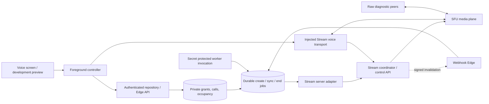

# Betweener Connect V1 independent forensic audit

Audit date: 2026-10-29. Repository: `C:\Projects\betweener-app`. Retained provider evidence targets Stream application **1731011, Betweener Staging**. This audit did not contact that application or any database. The only authored file is this report.

## 1. Executive summary

**Keep real calling disabled. M2A and M2B remain BLOCKED.** There are two distinct failures, plus separate application defects:

1. **CONFIRMED_BEHAVIOUR — revocation does not reach Stream when the end operation is suppressed.** The fault wrapper throws before the server SDK sends its `mark_ended` request. PostgreSQL commits grant revocation, terminal application state and an end job, but Stream retains admitted membership and an active session. A held, still-valid ordinary user JWT then obtains coordinator admission and establishes audio. This is an established cross-system enforcement gap, not evidence of a Stream service outage. Sources: `scripts/lib/connect-stream-closure-worker.ts:27`, `supabase/functions/_shared/connect-consent-revocation.ts:9`, `supabase/functions/_shared/connect-provider-worker.ts:12`, retained `stream-staging-connect-m2a-closure-evidence.json:511` and boundary receipt at `stream-staging-connect-revocation-boundary-evidence.json:937`.
2. **CONFIRMED_BEHAVIOUR — the experimental timer did not demonstrate a media cutoff.** On the second approved call, two fresh inbound-RTP samples taken after an ended provider read show increases of **25,956/26,208 bytes and 103/104 packets**. Both subscriber connections remain connected. This observation is stronger than a sender counter or an ended timestamp. It does not identify when those packets were generated or the provider's internal termination mechanism. Sources: boundary receipt `:2259` onward; `scripts/lib/connect-stream-sfu-session.cjs:206`; detailed timeline below.
3. **CONFIRMED_DEFECT — the production adapter ignores call-level `ended_at`.** It observes only `session.ended_at`; when the provider has no session it returns `null`. The sync worker then successfully completes without reconciling an ended call. Two offline counterexamples executed against the actual adapter and worker reproduced this. This defect can leave application state stale; it cannot explain the recorded timer traffic because that application's database call was already terminal. Sources: `supabase/functions/_shared/connect-stream-adapter.ts:120`, `supabase/functions/_shared/connect-provider-worker.ts:36`.
4. **CONFIRMED_DEFECT — admission-time expiry cleanup can roll back.** `rpc_connect_admission` invokes `connect_expire`, then raises when the resulting state is terminal. An uncaught exception rolls back that RPC transaction, including newly enqueued cleanup. Admission remains denied; cleanup must be committed by another path. This is a static transaction finding, not a newly executed database test. Source: `supabase/migrations/20261028074908_connect_v1_foundation.sql:352`.
5. **TEST_GAP — the restart experiment is inconclusive.** Coordinator admission succeeded, but both restarted raw SFU peers failed before audio. The historical decoder lost the nested error code, and a dead child was subsequently queried. `timerResetObserved=false` is not a valid non-reset result. Sources: boundary receipt `:2824`; `scripts/test-connect-revocation-boundary.cjs:159`; `scripts/lib/connect-stream-sfu-session.cjs:111`.

The normal-end control and timer path have different observed SFU outcomes even though both raw clients intentionally ignore end cleanup. Normal backend end produced SFU `callEnded` events and flat receiving counters while local sending continued. Timer expiry produced ended metadata without that recorded SFU event and with increasing receiving counters. **The exact provider-side reason for this divergence is UNKNOWN.** The raw harness does not subscribe to the separate coordinator event channel; absence of its SFU event cannot establish absence of coordinator `call.ended`.

The fresh offline regression run passed **87/87**. These tests verify application logic, mocks and receipt interpretation; they do not establish SFU enforcement. No provider writes, database access, source fixes, cleanup, build, deployment or device validation were performed. One bounded follow-up experiment is proposed in section 19 and was not run.

## 2. Audit scope

The review covered current Connect source, relationship authority migrations, worker and adapter code, installed SDK source, tests, reports 00–16 and 18, proposal files, tracked receipts and retained original files under `tmp/`. Report 17 does not exist in the inspected directory. `connect-v1-architecture-audit.md` is a historical pointer to report 01, not a second current implementation assessment.

Evidence levels used throughout:

| Level | Meaning | Limit |
|---|---|---|
| Current source | Code inspected in this checkout | Does not prove deployment, scheduler installation or current provider settings |
| Fresh offline execution | Pure Node tests and two in-memory adapter counterexamples | No real database, provider or physical media device |
| Retained integration receipt | Previously executed disposable database/provider experiment | Dated evidence; no fresh external verification in this audit |
| Documentation | Official documentation checked during this audit | Describes a contract, not packet-level proof for the fixture |
| Inference | Reasoned consequence of source and observations | Explicitly separated from measured behaviour |

The source/config/report baseline contains 190 hashed files. Unrelated pre-existing Live, Studio, Circle and package changes are outside the audit's mutation scope. Original evidence was read, not regenerated. The boundary original `tmp/connect-boundary/provider-results.json` has SHA-256 `8c1d82141a5c5140c94ac2b65e2b09dca42ebbe1f0f8c87b852d6dacdffa501d`; the tracked `experiment.results` matches it after removing only opaque `calls[].handles`. No credentials, SDP or provider access tokens are reproduced here.

## 3. Source and evidence inventory

Line references below refer to this checkout. SQL references identify the migration defining the function; the M2A replacement of `rpc_connect_claim_job` takes precedence over the M1 definition. Table rows grouping closely related files enumerate their actual names.

### Application and native boundary

| File | Responsibility | Callers | Dependencies | Security boundary | Test coverage |
|---|---|---|---|---|---|
| `features/connect/domain/connect.ts:1` | States, transitions, snapshots, duration | Repository, controller, UI | Pure types/functions | Terminal-state and server-time representation | Foundation regressions |
| `features/connect/data/connect-repository.ts:10` | Injectable RPC repository | Service, tests | RPC port | No arbitrary actor supplied; server RPC authority | Foundation mocks |
| `features/connect/data/connect-service.ts:10` | Supabase binding; Edge consent revoke | App-facing service | Supabase client, repository | Authenticated RPC/Edge request | Revocation mocks |
| `features/connect/data/voice-service.ts:7` | Voice API and credentials response validation | Controller dependency factory | Supabase Edge invocation | Validate user, media, CID and expiry | Voice regressions |
| `features/connect/voice/voice-types.ts:5` | API/media/permission contracts | Controller, transport, preview | Domain | Explicit injectable ownership ports | Voice regressions |
| `features/connect/voice/voice-controller.ts:20` | Initiate/answer/decline, canonical reload, media lifetime, reconnect, logout | Preview; future runtime owner | API, permission, transport, clock | Generation/device/version fences; local cleanup | Voice regressions |
| `features/connect/media/stream-voice-transport.ts:29` | Join/leave, camera off, microphone, state subscription, release | Injected voice controller | Supplied Stream bindings factory | Identity fencing and local media cleanup | Voice regressions, mocked Stream objects |
| `features/connect/media/microphone-permission.ts:7` | Permission result normalization | Controller permission dependency | Permission port | Prevent capture before permission | Voice regressions |
| `features/connect/media/native-microphone-permission.ts:1` | Expo microphone request | Future runtime composition | Expo Audio | OS capture permission only | No physical-device evidence |
| `features/connect/voice/voice-preview.ts:7` | Fake API/media for UI | Preview route | Controller | Explicitly synthetic | UI/controller tests |
| `features/connect/components/VoiceCallScreen.tsx:1` | Voice presentation | Preview route | Domain, controls | Displays supplied state; no provider authority | Retained 7 UI interaction tests |
| `features/connect/components/VoiceCallControls.tsx:21` | Mute/output/end controls | Voice screen | Callback ports | Accessible UI, no direct authorization | Retained UI tests |
| `app/connect/voice-preview.tsx:9` | Development preview ownership, ticks, AppState, disposal | Expo Router | Fake preview/controller | `__DEV__` gate at line 40 | Retained UI evidence; no real media |
| `app/_layout.tsx`; `lib/auth-context.tsx` | App/auth ownership | Root app | Existing providers/auth | No installed real Connect owner/logout host found | Native integration gap |
| `features/live/media/stream-video-client-leases.ts:20` | Existing shared SDK client leases | Live provider | Map/refcounts | Last lease disconnect; first factory wins | Existing Live suites; not Connect media proof |
| `features/live/media/stream-live-media-provider.ts:122` | Live SDK ownership and audio setup | Live screens | Stream SDK, lease registry | Live token closure and teardown | Retained Live regressions |
| `features/live/media/stream-video-background-client.ts:6`; `index.js:6` | Existing Live client registration and push callback | Stream native push | Callingx/Stream RN SDK | Shared app-wide registration; no Connect selection | No Connect cold-start evidence |
| `app.config.js:467`; `eas.json`; `package.json`; `package-lock.json` | Build/plugin/dependency configuration | Expo/build tooling | Native SDKs | Configuration is not an installed-device guarantee | Read only; no build |

### Database and server

| File | Responsibility | Callers | Dependencies | Security boundary | Test coverage |
|---|---|---|---|---|---|
| `supabase/migrations/20261028064220_relationship_acceptance_authority.sql:60` | Pair locks, immutable decisions/proofs, relationship revocation, legacy/admin wrappers | Relationship and Connect RPCs | Auth/profile mappings, existing source tables | Two independent decisions; block/withdrawal override | Retained M0 SQL/races/HTTP, relationship tests |
| `lib/relationships/relationship-commands.ts:19`; `lib/relationships/relationship-service.ts:6` | App relationship commands and Supabase binding | Relationship UI/services | Relationship RPCs | Server derives actor; client cannot certify a relationship | Relationship command regressions |
| `supabase/migrations/20261028074908_connect_v1_foundation.sql:9` | Flags, grants, sessions, occupancy, jobs, all Connect RPCs | Authenticated users and service workers | Relationship authority | Private tables, ACLs, actor checks, leases and transitions | Retained SQL/HTTP/races; foundation mocks |
| `supabase/migrations/20261028143424_connect_m2a_revocation_cleanup.sql:4` | Durable orphan claim fix and atomic revoke/claim-end API | Consent Edge, worker | M1 jobs | Durable call ID, leases, atomic obligation | Retained 20-case revocation suite |
| `supabase/functions/_shared/connect-environment.ts:2` | Supabase target fence | Edge factory | Environment | Local/staging allowlist, production rejection | Foundation regressions |
| `supabase/functions/_shared/connect-edge.ts:3` | Pinned clients, env/auth/RPC helpers | Four Connect Edge functions | Deno imports, secrets | Server credential confinement and safe errors | Static/Deno checks retained |
| `supabase/functions/_shared/connect-stream-adapter.ts:67` | Application/type policy, binding, provision, JWT, end, observation | Credentials and worker | Node SDK port | Exact app/type/roles/member/media policy | Foundation mocks; retained real-provider receipts; fresh counterexamples |
| `supabase/functions/_shared/connect-provider-worker.ts:12` | End retry, create compensation and sync | Worker Edge, revoke orchestration | Adapter/store ports | Explicit successful ACK required | Foundation/revocation regressions |
| `supabase/functions/_shared/connect-consent-revocation.ts:9` | Commit revoke then attempt claimed ends | Revoke Edge | Store and provider worker | Database commit before best-effort provider work | Consent/security closure mocks |
| `supabase/functions/_shared/connect-webhook.ts:1` | Signature and event identity validation | Webhook Edge | Web Crypto | HMAC, time window, CID allowlist | Foundation regressions |
| `supabase/functions/connect-credentials/index.ts:7` | Bearer validation, admission, mint, readmission | Voice service | Auth, DB RPC, adapter | No arbitrary user/CID mint; post-side-effect fence | Retained HTTP tests; mocked server code |
| `supabase/functions/connect-revoke-consent/index.ts:19` | Actor revoke and bounded fast cleanup | Connect service | Atomic RPC, claim/complete, adapter | 200/202 reflects ACK state, not received-media state | Consent tests and retained integrated fixture |
| `supabase/functions/connect-provider-worker/index.ts:8` | Secret-protected sweep and one job per invocation | Intended scheduler | Service RPCs, adapter | Service-only work claims | Retained isolated worker execution; scheduler unverified |
| `supabase/functions/connect-webhook/index.ts:7` | Signed invalidation → durable sync | Stream webhook delivery | Signature helper, enqueue RPC | Events do not directly mark ACTIVE/terminal | Local validation only; hosted delivery unverified |
| `supabase/functions/connect-credentials/deno.json`; `connect-revoke-consent/deno.json`; `connect-provider-worker/deno.json`; `connect-webhook/deno.json` (all under `supabase/functions/`) | Import/Edge configuration | Deno functions | Explicit SDK versions | Reproducible direct version, no inspected Deno lock | Retained Deno checks |

### Diagnostics, tests and receipts

| File | Responsibility | Callers | Dependencies | Security boundary | Test coverage |
|---|---|---|---|---|---|
| `scripts/audit-connect-stream.ts`; `scripts/lib/connect-stream-audit.ts` | Provider app/type read-only audit and normalization | Prior audit CLI | Server SDK | Identity/policy readback | Retained app/type receipts |
| `scripts/configure-connect-stream-staging.ts` | Approved scoped provider configuration | Prior approved CLI | Proposal, SDK | Mutating; not invoked here | Retained before/after hashes |
| `scripts/test-connect-stream-staging.ts` | Coordinator and permission negatives | Prior approved fixture | SDK, owned users | Separate 401 vs 403; outsider token test | Retained 34-request receipt |
| `scripts/lib/connect-stream-verdict.ts` | Coordinator receipt classification | Prior CLI, tests | Pure receipt data | No coordinator PASS implies RTP cutoff | Stream evidence regressions |
| `scripts/test-connect-consent-stream.cjs` | Real adapter + disposable DB revocation | Prior approved fixture | DB helper, fixture bridge | Fault injection, retries, held admission | Retained 10 integrated checks |
| `scripts/test-connect-video-stream.cjs` | Consenting synthetic VIDEO probe | Three earlier approved fixtures | Fixture/DB/SFU helpers | Owned users, per-call media only | Retained failed attempts and corrected 4-check pass |
| `scripts/lib/connect-stream-closure-worker.ts:27` | Real SDK fixture port, isolated fault, roles, provider reads and cleanup | Fixture bridge | Pinned SDK, owned ledger | Throws before end HTTP; hard cleanup closes peers first | Retained actual provider receipts |
| `scripts/lib/connect-stream-fixture.cjs:7` | Cached Deno child and request bridge | Integrated/boundary drivers | Deno/Node child I/O | Request IDs, bounded waits | Offline mocks; retained startup failure |
| `scripts/lib/connect-stream-sfu-protocol.cjs:6` | Load exact installed generated protobuf | Raw peer child | Installed video-client source | Protocol provenance, no server logic | Retained SFU probes |
| `scripts/lib/connect-stream-sfu-probe.cjs:9` | JSON command process | Fixture worker | Raw session | Open/subscribe/stats/close | Retained child errors |
| `scripts/lib/connect-stream-sfu-session.cjs:14` | Synthetic tracks, SDP/ICE, SFU WS/Twirp, stats | Probe process | Chrome/WebRTC, protobuf | Non-cooperative raw media; no hardware | Retained RTP observations; local controls |
| `scripts/lib/connect-stream-closure-verdict.ts` | Media/permission/revocation classification | Closure/video diagnostics | Pure receipt data | Keeps known revocation failure blocked | Security closure regressions |
| `scripts/audit-connect-revocation-boundary.ts` | Read-only lease/timer capability inventory | Prior boundary audit | SDK/config evidence | No timer enforcement claim from fields | Retained audit receipt |
| `scripts/test-connect-revocation-boundary.cjs:74` | Three-call orchestration, manual worker drive | Exhausted prior approval | Disposable DB and real provider fixture | Normal control, failed end, timer, restart | Retained INCOMPLETE run, not rerun |
| `scripts/lib/connect-revocation-boundary-verdict.cjs:12` | Counter/end/rejoin verdict | Boundary driver and tests | Pure result JSON | Fail/inconclusive and hard blocked gates | 5 fresh offline tests |
| `scripts/test-connect-synthetic-offer.cjs` | Local offer/publisher controls | Earlier local diagnostic | Local Chrome peers | No provider enforcement conclusion | Retained synthetic pass |
| `scripts/lib/connect-test-database.cjs:1` | Clone fixture DB, REST and cleanup | SQL/integration drivers | Local Postgres/Supabase | Mutates isolated DB; forbidden in this audit | Retained setup/cleanup receipts |
| `scripts/test-connect-security.cjs`; `scripts/test-connect-revocation.cjs` | Actual isolated SQL/HTTP/race assertions | Earlier local validation | DB helper; synthetic provider ACKs in latter | DB authority/lease proof, not real SFU cutoff | Retained 67-case and 20-case runs |
| `scripts/test-relationship-security.cjs` | M0 SQL/races/HTTP validation | Earlier remediation | Local isolated DB/REST | Relationship proof authority | Retained 88 SQL, 6 race and 4 HTTP assertions |
| `scripts/prepare-connect-edge-check.cjs` | Temporary Edge check preparation | Prior validation | Deno tooling | Writes preparation files; not invoked | Retained compatibility receipt |
| `supabase/tests/connect_v1_authority.sql`; `supabase/tests/fixtures/connect_v1.sql` | ACL/RLS assertions and fixture schema | DB drivers | Migrations | Actual grants/SECURITY DEFINER, not media | Retained 15 authority checks |
| `supabase/tests/relationship_acceptance_authority.sql`; `supabase/tests/fixtures/relationship_acceptance_legacy.sql`; `relationship_acceptance_races.sql` (same fixtures directory) | Legacy exploits, repaired authority, races | M0 driver | Relationship migration | Reject mutable-label certification | Retained M0 evidence |
| `supabase/verification/connect_v1_m0_relationship_authority_audit.sql:1` | Historical exploit reproduction with synthetic writes inside rollback | Prior M0 investigation | Local PostgreSQL and pgTAP | Nine assertions reproduce the old blocker; not safe to classify as read-only | Historical M0 results; not executed here |
| `__tests__/connect-foundation.regression.test.ts` | Pure policy/domain/adapter/worker tests | Node test runner | Mocks | 21 cases | Fresh PASS |
| `__tests__/connect-voice.regression.test.ts` | Controller/transport races and cleanup | Node test runner | Fake clocks/API/SDK | 36 expanded cases | Fresh PASS |
| `__tests__/connect-consent-revocation.regression.test.ts` | Revoke orchestration and ACK fences | Node test runner | Mock store/provider | 9 cases | Fresh PASS |
| `__tests__/connect-stream-evidence.regression.test.ts` | Receipt classification | Node test runner | Synthetic fixtures | 4 cases | Fresh PASS |
| `__tests__/connect-security-closure.regression.test.ts` | Security/publisher/revoke verdict | Node test runner | Synthetic receipts | 12 cases | Fresh PASS |
| `__tests__/connect-revocation-boundary.regression.test.cjs` | Boundary verdict negatives | Node test runner | Synthetic receipts | 5 cases | Fresh PASS |
| `__tests__/connect-voice.interaction.test.tsx` | Presentational controls | Jest | React renderer/fakes | 7 retained cases | Not rerun; not native media |

The inventory deliberately identifies absent runtime pieces: no actual Connect Stream client initializer/context host, authenticated owner wiring, real incoming-call navigation, native audio-route binding or video screen is installed. Injectable interfaces and a preview are present. Live's implementations are dependencies/risk references, not proof that Connect uses them.

### Historical evidence chain

All paths in this table are under `docs/betweener-connect/` unless an original `tmp/` path is specified.

| Files/receipt | Historical result and independent interpretation |
|---|---|
| `00-relationship-security-remediation.md`; `01-connect-v1-architecture-audit.md` | Mutable accepted labels could previously certify a unilateral relationship. M0 introduced independent decisions/proof and revoked unsafe writes. Their early blocker headings are historical, not a description of current Connect runtime. |
| `02-connect-v1-implementation-plan.md`; `03-connect-v1-security-model.md`; `04-connect-v1-call-state-machine.md` | Intended server authority and separate provider lifecycle. Plans are not implementation evidence. |
| `05-connect-v1-native-calling-setup.md`; `06-connect-v1-ui-design-system.md`; `07-connect-v1-test-matrix.md`; `08-connect-v1-rollout-and-rollback.md`; `09-connect-v1-known-limitations.md` | Native/device/release requirements and acknowledged missing production integration. No physical-device pass inferred. |
| `10-connect-v1-final-validation.md`; `11-connect-v1-m1-implementation.md` | Local authority and foundation results: initially 19 then 21 foundation cases, 15 ACL assertions, expanded 67 DB/security cases. These are DB/application claims. |
| `12-connect-v1-stream-configuration-checklist.md`; `stream-staging-connect-proposal.json`; `stream-staging-connect-validation.json` | Approved three roles and dedicated type; retained policy audit and coordinator negatives. They do not prove immediate media revocation. |
| `13-connect-v1-m2-security-validation.md`; `14-connect-v1-m2-voice-implementation.md`; `15-connect-v1-m2-device-test-plan.md`; `local-m2-revalidation.json` | Foreground voice shell, local tests and device plan; real native calling remains gated. |
| `16-connect-v1-m2a-security-closure.md`; `stream-staging-connect-m2a-closure-evidence.json`; original `tmp/connect-m2a/integrated-results.json` | Integrated 2026-10-28 14:46:49.313Z run: actual DB + adapter, 10 checks, end suppressed before HTTP, held JWT joined and sent audio after DB revoke. Healthy recovery denied both held identities. Source's job-ID/orphan and false-ACK defects were subsequently repaired; retained receipts must be read with that chronology. |
| Same closure receipt, coordinator section; original local results | 2026-10-28 15:01:20.992Z coordinator-only matrix: 34 requests. Invalid JWT 401 and permission denial 403/code17 are different. The Live token subject was an outsider, not a previously authorized pair member. |
| `stream-staging-connect-video-security-proposal.json`; `-retry-proposal.json`; `-verification-proposal.json`; `stream-staging-connect-video-security-evidence.json` | Three separately approved VIDEO attempts. 15:48:33.535Z failed locally; 16:01:58.437Z diagnostic proved one VP9 publisher but audio/PC replacement failed and setup outlasted its DB deadline; 16:17:16.927Z corrected run passed four checks with simultaneous audio/video send counters for both members. No remote video rendering or positive RTCP reception was proved. |
| `18-connect-v1-revocation-boundary-decision.md`; `stream-staging-connect-boundary-proposal.json`; `stream-staging-connect-revocation-boundary-evidence.json`; original `tmp/connect-boundary/provider-results.json` | 2026-10-29: normal end had a receiving plateau; timer metadata ended while receiving grew; empty-session restart was inconclusive. Overall result INCOMPLETE and security FAIL. All three approvals consumed. |
| Retained startup/cleanup logs under `tmp/connect-boundary/` and tracked cleanup summaries | First startup at 06:32:50.922Z timed out before creating any call. The approved provider run began 06:36:48.085Z using cached Deno. Retained final cleanup reports three calls absent (404/code16), owned users absent and unchanged shared type hash. Not rechecked externally here. |

Earlier raw probes had OFF quality enum, premature close, SDP/RID/ICE and publisher-replacement problems. Generic SFU errors from those probes are not permission denials. Corrected explicit permission denials and positive RTP controls have higher evidentiary value than the earlier failed probes. The current raw-peer error decoder and restart guard were corrected after the boundary run; there is no immutable run-start harness source hash. The original failed results remain authoritative for what ran.

## 4. Full component architecture



**CONFIRMED_BEHAVIOUR:** database authorization, provider control state, SFU transport state and local UI/media ownership are different authorities. PostgreSQL does not have a transaction with Stream. Webhooks enqueue re-observation; they do not prove packet cessation. See `connect-webhook/index.ts:7`, `connect-provider-worker.ts:36`, M1 migration `:442`.

Disagreement points include: DB REQUESTED before provider provision; provider created before create ACK; DB accepted before role promotion/SFU join; role promotion before the credentials endpoint's second admission check; roster membership before trustworthy media evidence; local hangup before server end; DB terminal before provider ACK; provider ended metadata before observed receiving cessation; received end event before SDK local cleanup; completed end job before any independent media-verification receipt. A local failure between these steps must not be relabelled as an atomic cross-system success.

Current settings have no finite absolute media lifetime: the normal retained type has `max_duration_seconds=null`, ACTIVE has no deadline and a 120-second JWT is not an established active-media lease (`connect-stream-adapter.ts:3`, M1 migration `:155`). No five-minute product limit is approved or implemented by this audit.

## 5. Call lifecycle sequence diagrams

Solid arrows below represent requested synchronous operations; dotted arrows represent asynchronously delivered events. Durable jobs are explicitly labelled. These are code paths, not claims that the production scheduler/native host exists.

```mermaid
sequenceDiagram
  participant U as Authenticated caller
  participant E as Authenticated credentials Edge
  participant D as PostgreSQL RPC
  participant J as Durable jobs / worker
  participant S as Stream control API
  participant R as Recipient
  participant M as Client / SFU
  U->>D: create_call(peer, media, auth mode, key, device, grant)
  D->>D: Pair/user locks, proof/grant, flags, occupancy
  Note over D: A: matched proof; B: directional consent; C: video-specific grant/flags
  D->>J: Persist create job in same transaction
  D-->>U: REQUESTED snapshot
  J->>D: Claim leased create job and snapshot
  J->>S: Verify app/type; getOrCreate with invited pair
  J->>D: Recheck eligibility, complete create or compensate end
  S-->>R: Ring notification (runtime provision configuration)
  R->>D: act(accept, version, device)
  D-->>R: ACCEPTED, canonical device selected
  U->>E: Request own credentials
  R->>E: Request own credentials
  E->>D: Validate actor and admission, load service snapshot
  E->>S: Verify app/call; promote media membership
  E->>D: Second admission check after provider side effect
  E-->>U: Own short-lived JWT and exact CID
  E-->>R: Own short-lived JWT and exact CID
  U->>M: Coordinator join then SFU SDP/ICE/media
  R->>M: Coordinator join then SFU SDP/ICE/media
  S-->>J: Signed event invalidation, asynchronously delivered
  J->>S: GET canonical provider session
  J->>D: reconcile session/users/ended
  D-->>U: ACTIVE only from trusted reconciliation
```

Credential checks and minting above apply independently to both users; server token signing happens inside the Edge process. Browser/native clients do not hold the server secret. Decline/cancel uses the same versioned action RPC but transitions to a terminal state and queues end instead of requesting credentials.

| Path | Exact entry/functions and actor | Authority, requests and transitions | Failures, retries and cleanup |
|---|---|---|---|
| A. Matched voice | `VoiceController.start`, `features/connect/voice/voice-controller.ts:55`; repository `createCall`, `features/connect/data/connect-repository.ts:19`; `rpc_connect_create_call`, M1 migration `:268` | Actor derives from `auth.uid()`. `connect_authorized:115` requires current pair availability, accepted relationship **and independent proof**, recipient preference and enabled flags. REQUESTED→leased provider provision→RINGING→accept/join/reconcile. | Ordered user locks/occupancy reject conflicting calls; key is payload-bound. Adapter `provision:89` creates only eligible REQUESTED snapshots. Worker `:31` rechecks and compensates stale creation. No UI route currently invokes this with real bindings. |
| B. Pre-match voice | `rpc_connect_request_grant`, M1 `:216`; `rpc_connect_decide_grant:238`; same create path `:268` | Actor-owned source intent, directional recipient decision, voice bit, expiry and pair revocation watermark. No arbitrary accepted label substitutes for consent. | Revoked grant/source/block denies new create/admission. New consent requires a valid new source; old call terminality is preserved. Grant rejection/revoke does not directly control the SFU. |
| C. Video | Same server create/admission with `p_media='video'`; adapter `:33`, `:89`, `:104` | Dedicated video role adds `send-video`; voice role does not. Video is enabled only for a video call with matching grant/flags. Screen/recording/captions/ingress/broadcast remain off. | No real native Connect video screen/transport is installed. Corrected fixture proves simultaneous synthetic sending, not native device capture or rendering. Per-call media/type mismatch fails closed. |
| D. Acceptance/rejection | Controller `accept:94`; `rpc_connect_act`, M1 `:298` | Only recipient can accept/decline; caller can cancel before acceptance. Version and selected device checked; accept returns ACCEPTED and queues sync. Credentials admission `:352` moves accepted to CONNECTING. | Permission denial avoids joining; version/device conflict reloads canonical state and leaves. Already terminal calls cannot be revived. API/permission errors use safe messages. |
| E. Normal end | Controller `hangup:128`; `endOnServer:111`; `rpc_connect_act:298`; `runConnectEndJob`, provider worker `:12`; adapter `end:116` | Local capture/transport leaves first for a cooperative caller. DB ENDING + end job; actual server SDK `call.end()` POSTs `mark_ended`. Successful lease ACK finalizes terminal state and eligible occupancy release. | Controller end RPC is best effort with reload/one retry; durable job is the fallback. Failure persists job and occupancy. Normal raw-peer control bypasses local leave and still records receiving plateau. |
| F. Active consent revoke | `connect-service.ts:17`; revoke Edge `index.ts:19`; `revokeConnectConsent`, shared revocation `:9`; `rpc_connect_revoke_consent`, M2A `:18` | Authorized participant commits grant revoked + affected calls ENDED + durable end obligations atomically. Edge then claims/ends up to 20 returned calls. Other pending jobs remain durable. | Returns providerCleanup pending or complete based on real worker ACKs. Complete is not media verification. Duplicate revoke is idempotent; terminal UI reload leaves. |
| G. Failed provider end | Worker `:12`; fault fixture `connect-stream-closure-worker.ts:27`; M1 `rpc_connect_complete_job:395` | DB revoke already committed. Wrapper throws before HTTP; Stream gets no revocation information through this operation. Job retries, occupancy stays held. Held JWT coordinator join was 201 and real audio established. | Exponential retry (maximum reached by current expression is 256 seconds, capped at 300) plus 60-second claim lease. Worker needs repeated scheduling. A retained retry was manually made due; not proof of production scheduling. |
| H. Temporary network loss | Controller `connectAudio:172`, `tick:231`, `setForeground:258`; transport `:14`, `:39`; SDK `Call.ts:2093`, `:2419` | SDK handles reconnection/rejoin/ICE strategies; controller presents recovery only when canonical state permits it, polls while foreground and limits local recovery to 30 seconds. Refreshed credentials use actual admission and same user/key/CID validation. | SDK disconnect strategy leaves; terminal DB reload retires transport. Eventual rejoin through held JWT before end enforcement remains possible for a malicious peer; local guards cannot revoke it remotely. |
| I. Ended call rejoin | Adapter `credentials:104`; DB admission `:352`; provider ended-call permission | DB terminal rejects credential issue. Retained explicit backend-end matrix: still-valid held/fresh JWT GETs 200, joins 403/code17. Same-ID create returned existing ended call (201), not a new live call. | No `join-ended-call` grant exists for Connect roles. No tested timer-only fresh/held rejoin matrix before forced end; no join after same-ID recreate POST. Do not generalize those missing tests. |
| J. Process restart | Durable tables M1 `:60`; replacement claim M2A `:4`; worker Edge `:15`; controller `logout/dispose:270` | DB obligation survives worker/app process memory. Expired leases can be reclaimed; durable call IDs survive deleted session rows. A resumed authenticated owner must load canonical state and never auto-resurrect terminal calls. | This is persistence/reclaim design plus retained lease tests, **not an actual process-kill/restart provider test**. Real Connect startup/restoration owner and deployed scheduler are absent/unverified. Third fixture restarted raw peers, not backend process recovery. |

```mermaid
sequenceDiagram
  participant C as Controller / resumed owner
  participant T as SDK transport
  participant D as PostgreSQL authority
  participant S as Stream coordinator / SFU
  participant W as Later worker invocation
  Note over C,S: H: temporary transport loss
  S-->>T: Disconnect / reconnect strategy
  T-->>C: Reconnecting state
  C->>D: Reload canonical call; refresh admission when required
  alt Canonical call still eligible and nonterminal
    T->>S: SDK reconnect / rejoin with valid credentials
    S-->>T: Media established or explicit failure
  else Revoked or terminal
    C->>T: Stop local media and leave; retire CID
  end
  Note over C,S: I: stale raw peer can bypass local controller
  T->>S: Held JWT join for ended CID
  S-->>T: 403/code17 measured after actual backend end
  Note over D,W: J: process memory lost, durable job remains
  W->>D: Reclaim due job after lease expiry
  D-->>W: Durable call ID and new lease
  W->>S: Idempotent end request
  W->>D: Complete only current lease after successful end
  Note over C,W: Requires installed owner/scheduler; restart execution not verified
```

## 6. Consent revocation sequence diagrams

```mermaid
sequenceDiagram
  participant U as Authorized grant participant
  participant E as Revoke Edge
  participant D as PostgreSQL
  participant W as Leased end worker
  participant S as Stream control API
  participant P as Raw peers / SFU
  U->>E: Revoke grant with bearer identity
  E->>D: rpc_connect_revoke_consent
  D->>D: Pair lock; revoke grant; terminal calls; enqueue ends
  D-->>E: Committed revoked=true, pending count/call IDs
  E->>D: Claim specific pending end, obtain lease
  E->>W: Run end job
  alt End request reaches provider
    W->>S: POST mark_ended
    S-->>W: API response
    W->>D: Complete only current lease with success=true
    S-->>P: End signaling, asynchronous
    Note over P: Normal fixture: receiving plateau; PCs still connected
  else Local fault suppresses request
    W->>W: Throw before SDK HTTP
    W->>D: Record failure, retain job and occupancy
    Note over S,P: Membership/session not changed by DB revocation
    P->>S: Held JWT coordinator rejoin
    S-->>P: 201 observed before real provider end
  end
  E-->>U: Revoked; cleanup complete/pending based on ACKs
```

```mermaid
sequenceDiagram
  participant D as DB already revoked / ENDED
  participant S as Stream metadata/timer
  participant P as Non-cooperative raw peers
  participant W as Recovery worker
  S->>S: Session deadline 06:39:45.198Z
  S->>S: ended_at=06:39:46.823Z, session absent
  P->>S: GET after metadata ended
  S-->>P: ended=true, users=[]
  Note over P: Samples 49.371Z and 51.428Z: receive bytes/packets increase
  Note over P: No SFU callEnded recorded; coordinator WS not observed
  W->>S: Later explicit mark_ended after end port restored
  W->>D: Real API/lease ACK, release eligible occupancy
  P->>S: Held and fresh JWT joins
  S-->>P: 403/code17
  Note over P: No receiver sample after this recovery; cutoff time UNKNOWN
```

**CONFIRMED_BEHAVIOUR:** the healthy fast path attempts termination after DB commit, not in the transaction. Provider failure cannot undo committed revocation. Conversely, DB revocation alone cannot erase Stream membership or a previously issued credential. Source: shared revocation `:9–21` and adapter credentials `:104–114`.

## 7. Stream SDK and media lifecycle findings

### Version and implementation provenance

| Component | Verified source | Version / interpretation |
|---|---|---|
| React Native video SDK | Root lockfile and installed `node_modules/@stream-io/video-react-native-sdk/package.json` | **1.46.3**; manifest range `^1.46.3` |
| JavaScript video client | Lockfile and installed `node_modules/@stream-io/video-client/package.json` | **1.62.0**, transitive SDK implementation inspected |
| Stream React Native WebRTC | Lockfile/installed manifest | **145.4.1** |
| Callingx | Lockfile/installed manifest | **0.11.5** |
| Server Node SDK | `_shared/connect-edge.ts:3`, Edge Deno imports and cached Deno npm manifest/source | **0.7.63**, explicit import pin. Not a root npm dependency; no inspected `deno.lock`. Direct version verified, complete transitive lock reproducibility not established. |

Server SDK source below is under `C:\Users\HP\AppData\Local\deno\npm\registry.npmjs.org\@stream-io\node-sdk\0.7.63\src\`. Client references are under `node_modules/@stream-io/video-client/src/`.

| Question | Finding and source |
|---|---|
| End a call | Server `gen/video/CallApi.ts:168` delegates to `VideoApi.endCall`; `gen/video/VideoApi.ts:521` POSTs `/api/v2/video/call/{type}/{id}/mark_ended`. Client `Call.ts:3272` uses the same endpoint. **Wrong termination API is not supported by inspected code.** |
| Leave locally | Client `Call.ts:712` disposes subscriber/publisher, calls SFU leave/close, clears participants/listeners, stops devices/media engine. It does not mean end for everyone. `StreamSfuClient.ts:449` attempts leave notification and closes its socket. |
| End active media session | No separately invoked, independently proven SFU kill primitive exists in the Connect adapter. Provider-side implementation of `mark_ended` and timer expiry is opaque. Official call lifecycle documentation says ending an active call terminates the session and kicks users; that contract does not measure the fixture's packet cutoff. [Stream call lifecycle](https://getstream.io/video/docs/api/call-lifecycle/). |
| Remove one participant | Server `CallApi.ts:162` kick and `:108` block delegate to control API. A kick alone permits rejoin; blocking can prevent it. Capability changes can revoke send permissions. These are distinct from local leave and require successful provider control. [Stream moderation](https://getstream.io/video/docs/api/moderation/overview/). |
| What actually stops forwarding | Only provider SFU behaviour or removal of the receiving transport can establish that. A method name, HTTP ACK, roster or SDK event cannot independently prove remote packet discard. The normal raw control measured cessation in its observation window. |
| End listeners | `events/callEventHandlers.ts:39` registers coordinator `call.ended`; line 40 registers SFU termination handling. `events/call.ts:10` invokes leave on coordinator end; `:37` invokes leave on SFU `callEnded` (with a special livestream backstage case irrelevant to Connect grants). These are two different channels. |
| Backend end | Normal retained control: SFU event + receiver plateau. An official SDK client receiving either handled end path also closes its local transports. Source: `Call.ts:783–878`; raw receipt `:383`. |
| Timer expiry | Documentation says the timer starts with session join, ends the call and removes participants. It does not specify a finite packet-level enforcement delay or an absolute lease surviving session restart. The retained test confirms metadata timing but contradicts treating it as measured immediate raw-media cutoff. [Stream session timers](https://getstream.io/video/docs/javascript/ui-cookbook/session-timers/). |
| Timer/backend equivalence | Not established for the adversarial peer. The observed SFU event and receiving deltas differ. Their provider internals cannot be inferred from a shared ended field. |
| Does timer cause automatic SDK disconnect? | If a recognized coordinator/SFU end event arrives while a call is active, the inspected SDK invokes leave. There is no retained official-SDK timer fixture proving which channel arrived here. Raw peers intentionally do not leave and do not connect coordinator WS. |
| Is cleanup cooperative? | SDK disposal is cooperative local behaviour. The documented server contract also describes server-side termination. Evidence does not establish that all Stream termination is merely cooperative; nor may the integration rely on cooperative cleanup for hostile clients. |
| Resume reconciliation | Controller `voice-controller.ts:258` mutes on background, ticks on foreground and polls canonical state. SDK RN `providers/StreamCall/AppStateListener.tsx:72` may disable/resume camera, not revalidate Betweener consent. A real Connect provider/owner is not mounted. |
| Cached calls | `StreamVideoClient.ts:449` creates a new Call by default; only `reuseInstance:true` looks in the store. A claim that calls are always reused is false. Call reuse and multiple wrappers are possible choices; terminality is not enforced by object identity. |
| Cached clients | `StreamVideoClient.ts:127` keys `getOrCreateInstance` by API key/user; an existing instance retains its original configuration/token provider. Live leases `stream-video-client-leases.ts:20` also use the first factory. Sharing it with Connect without a multiplexed auth owner could keep a Live-specific refresh closure. **Potential future integration defect, not a cause of the two-process raw experiment.** |
| Reconnect | `Call.ts:2093`, `:2419` implement reconnect/migration/fallback and explicit DISCONNECT leave. They do not call Betweener's DB authorization on every forwarded packet. The transport's token refresh callback adds backend checks only when actually used. |

**TEST_GAP:** generated SFU protocol being sourced from client 1.62.0 and advertising SDK type 9 is not itself a mismatch: generated `SdkType` identifies 9 as PLAIN_JAVASCRIPT; REACT_NATIVE is 6. Two headless browser peers correctly use the former. No version incompatibility root cause was demonstrated.

Native ownership findings: `@stream-io/video-react-native-sdk/src/providers/StreamCall/index.tsx:36` mounts app-state and interruption helpers only when the provider is mounted. `AudioInterruptionTracer.tsx:18` traces iOS events; it does not enforce consent. `modules/call-manager/CallManager.ts:38` delegates Android Telecom routing where appropriate; `:339` records configuration and `:349` clears it, while internal call lifecycle owns native start/stop. A product control wired only to those public methods cannot be assumed to acquire/release audio focus. Connect's actual output binding and native lifecycle owner remain unimplemented.

## 8. Database/RPC findings

### What the authority layer does correctly

**CONFIRMED_BEHAVIOUR (source plus retained isolated tests):**

- Actor identity is derived from authenticated context and checked against current profile/account moderation (`M1:90`). Matched calls require independent relationship proof, not a caller-supplied accepted label (`M1:115`; M0 `:122`, `:566`). Pre-match authorization checks directional grant/media, current source intent, expiry and revocation watermark.
- Private tables have RLS and no direct ordinary-user writes (`M1:80`). Security-definer functions use a fixed search path and explicit EXECUTE grants (`M1:511`; M2A `:47`). RLS alone does not replace function/table privileges; both layers matter. [Supabase RLS guidance](https://supabase.com/docs/guides/database/postgres/row-level-security).
- Create uses pair plus ordered-user locks, payload-bound idempotency and occupancy across both roles (`M1:268`). A repeated key with changed payload cannot silently create another call.
- Grant revoke and affected terminal calls/end jobs share the same PostgreSQL transaction (`M1:255`; M2A `:18`). Explicit revoke does not suffer the admission rollback defect below.
- Call transitions are terminal-absorbing; trusted late reconcile cannot resurrect an ended row (`M1:144`, `:442`). New consent is not permission to reopen the old ID.
- Claims use row locks/skip-locked, a fresh UUID lease and a 60-second deadline. Completion checks the exact current lease/status (`M2A:4`, `:34`; M1 `:395`). Duplicate/stale workers cannot clear another lease's obligation.
- M2A claim uses durable `jobs.call_id`, retaining orphan end work after call-row deletion. `private.connect_delete_guard` queues end (`M1:504`). Missing application rows do not silently erase the provider cleanup obligation.
- Pending end retains occupancy; release is gated by successful end and resolution of outstanding create work (`M1:395`). This protects against stale in-flight provision creating a new orphan after premature release.
- A block INSERT **does have a direct Connect trigger**, resolving Auth IDs in both directions and marking affected calls terminal/enqueuing end (`M1:492`). Relationship block guard also revokes proof (`M0:534`). Other relationship rejection/source withdrawal is checked on subsequent authorization/reconciliation/sweep; it is not an instantaneous SFU command.

### Findings and limits

**CONFIRMED_DEFECT DB-1 — rolled-back cleanup on denied admission.** In `rpc_connect_admission` (`M1:352`), line 359 runs `connect_expire`; lines 361–362 then raise for the newly terminal state. There is no exception handler/independent transaction. Thus the denial succeeds as an access fence, but terminal/job writes newly made within this RPC do not survive its exception. Example: eligibility is lost after an otherwise active call, admission notices it and locally enqueues end, then throws; no committed cleanup results from this invocation. A later successful `get_call`, worker snapshot or sweep can commit it. PostgreSQL's ordinary uncaught exception semantics support this static conclusion. [PostgreSQL errors and messages](https://www.postgresql.org/docs/current/plpgsql-errors-and-messages.html). A corrective design should commit invalidation in a separate successful operation/structured denial result; no schema or function was changed here.

**ARCHITECTURAL_LIMITATION DB-2 — durable work is not a liveness guarantee.** Sweep checks due rows, with a 200-row bound, and schedules canonical observations (`M1:475`). Edge invocation sweeps then claims **one** job (`connect-provider-worker/index.ts:15`). No deployed scheduler, drain throughput, queue-age alert, backoff SLA or process-restart receipt was verified. With no repeated worker invocation, a durable pending job stays pending indefinitely. Occupancy prevents another DB-authorized call but does not stop an already admitted provider peer.

**CONFIRMED_BEHAVIOUR DB-3 — terminology conflates API ACK with media completion.** There are separate grant statuses, terminal call state and job states, but no persisted independently measured `MEDIA_TERMINATION_VERIFIED` state. Proposed conceptual model:

| Boundary | Current representation | Required interpretation / safer future representation |
|---|---|---|
| AUTHORIZATION_REVOKED | Grant revoked; call ENDED; reason/time | Application access denied at commit |
| PROVIDER_TERMINATION_PENDING | End job pending/working; occupancy retained | Obligation exists; provider access may remain |
| PROVIDER_TERMINATION_CONFIRMED | End job done after API and valid lease ACK | Rename/report as control-plane acknowledgement with timestamp and operation identity |
| MEDIA_TERMINATION_VERIFIED | Absent | Separate evidence/guarantee field, observation method, session IDs and uncertainty; never infer from ACK alone |

`providerCleanup=complete` in the Edge response currently means the third row, not the fourth (`connect-consent-revocation.ts:21`). `connect_snapshot` (`M1:132`) does not expose these cleanup distinctions to clients.

**TEST_GAP DB-4:** current actor/account checks do not explicitly query `auth.sessions` by JWT session ID (`M1:90`). Exact behaviour after Supabase session revocation but before access-token expiry was not established. No shared/deployed catalogue, runtime ACLs, function definitions or scheduler state was accessed. Retained isolated SQL results support repository intent, not current deployment attestation.

**CONFIRMED_BEHAVIOUR DB-5:** reconciliation trusts the authenticated provider roster/session as connected evidence (`M1:442`); it does not receive an RTP/decoded-media proof. Consequently an ACTIVE DB label must not be presented as measured bidirectional media. The boundary harness separately established positive receiving controls before its timer assertions.

## 9. Provider adapter findings

**CONFIRMED_BEHAVIOUR:** the adapter verifies staging application ID, auth/permission checks, dedicated call type, exact effective roles/settings, UUID CID/custom binding and exactly the two expected members (`connect-stream-adapter.ts:42`, `:67–85`). It upserts user identities without overwriting their global roles. Invited members have read only; credentials promote to voice/video role only after database admission. Unknown effective roles with unexpected grants and enabled recording/screen/ingress/broadcast features are rejected. Ordinary roles cannot end/update/create/extend calls, join ended calls or request extra permissions under the retained configuration.

**CONFIRMED_DEFECT AD-1:** `media()` reads `call.session`, returns null if absent, and sets `ended` from `session.ended_at` only (`:120–126`). Call-level `ended_at` is ignored. Fresh offline execution used the real adapter and real sync worker with a correctly bound, valid-policy mocked provider response:

| Provider response | Actual adapter output | Actual sync worker outcome |
|---|---|---|
| `call.ended_at` set, `session=null` | `null` | Completes successfully; never calls reconcile |
| `call.ended_at` set, retained session with `ended_at=null` and both users | `ended=false`, both users | Reconciles non-ended media; completes successfully |

These tests used in-memory ports only, with no SDK/provider/database invocation or file output. Current regressions did not catch this case. Fix design must preserve call-level terminality even without a session and define how to represent absent session IDs; do not invent a fake active session. Add regression cases before changing reconciliation. This is a DB/UI synchronization defect separate from raw SFU termination.

**ARCHITECTURAL_LIMITATION AD-2:** issued credentials are ordinary **user JWTs**, TTL 120 seconds, not a per-packet consent lease, not device-bound and not cryptographically bound by the adapter to a specific call (`:104–114`). Access currently depends on provider membership/type policy. Server-generated call tokens elsewhere in the app must not be assumed to restrict a user to only those calls: Stream documents call-specific access as additional grants. [Stream authentication](https://getstream.io/docs/platform/authentication/). The effective alternate-token case for a formerly authorized member during pending termination remains untested; the retained Live-token negative uses an outsider subject (`scripts/test-connect-stream-staging.ts:126`).

**ARCHITECTURAL_LIMITATION AD-3:** member promotion is an external side effect before the endpoint's second admission check (`connect-credentials/index.ts:21–24`). If revoke races that side effect, the final check suppresses delivery of the newly minted response but cannot atomically undo promotion or invalidate an older valid token. Create compensation/end jobs reduce orphan persistence only when provider operations subsequently succeed.

**TEST_GAP AD-4:** code16 end errors are treated as idempotent missing-call success (`:116–119`); actual API semantics/status and operation-specific errors deserve explicit coverage. Strict policy GETs and post-admission checks do not include an SFU cutoff test, scheduler guarantee or absolute lease assertion. These are not evidence that the wrong API was used.

## 10. Raw WebRTC harness findings

### Data path and integrity

`connect-stream-sfu-session.cjs:14–37` generates oscillator audio into an AudioContext media destination. Each owned browser has separate publisher and subscriber PeerConnections; there is no JavaScript local loopback between the two subscribers. `:76` creates a receive-only offer; `:139` sends authenticated SFU join; `:121` answers subscriber offers through `SendAnswer`; `:153` negotiates publisher codec and `:163` sends `SetPublisher`. Boundary mode is audio only. Remote ICE is buffered/applied; answer ICE gathering is capped at one second (`:48`). These steps establish a real SFU path when positive receive controls pass.

**CONFIRMED_BEHAVIOUR:** each sample initializes bytes/packets to zero, calls current `subscriber.getStats()` and sums current `inbound-rtp` audio rows (`:206–211`). It does not add the prior total or read a stored old counter. Sender counters are separately read from publisher stats (`:196–199`). Source inspection found no stale-reference/double-add mechanism explaining the two increasing receiver totals. It does not prove that all browser stats or aggregate SSRC assumptions are flawless.

**CONFIRMED_BEHAVIOUR:** the normal and timer measurement windows both intentionally leave raw peers running. SFU `callEnded` sets a flag/time but does **not** close PCs (`:117–120`). The normal control receives that event and stops receiving while still sending. The timer window records no such event and continues receiving. The explanation “the normal client voluntarily left but the timer client did not” is refuted for these windows. Final cleanup closes peers before end/delete and therefore cannot serve as server-cutoff evidence (`connect-stream-closure-worker.ts:201`).

### Confirmed harness defects and material gaps

| Label / finding | Code/evidence | Consequence |
|---|---|---|
| **CONFIRMED_DEFECT HN-1:** historical SFU error decoder lost nested code | Raw restart `sfu_join_error_undefined`; generated event wrapper contains `.error.error.code`; current fix `connect-stream-sfu-session.cjs:111` | Actual SFU restart denial cause UNKNOWN. Cannot reinterpret it as permission denial or timer enforcement. |
| **CONFIRMED_DEFECT HN-2:** historical driver reused failed child; null timer produced false reset flag | Boundary result `sfu_process_closed`; current guard in `test-connect-revocation-boundary.cjs:170` was added afterward | Restart did not test post-deadline media or non-reset. Current source cannot retroactively repair evidence. |
| **TEST_GAP:** only SFU event channel observed | Session `:100–142`; no coordinator SDK WS connection | No SFU `callEnded` is a narrow observation; coordinator `call.ended` could have been delivered to official clients elsewhere. |
| **TEST_GAP:** aggregate RTP counters lack content and per-packet provenance | Session `:206`; timer driver `:149–150` | No SSRC, track ID, stats timestamp, last packet timestamp, RTP sequence/timestamp or decoded content nonce. Cannot separate post-deadline generated speech from previously queued/retransmitted packets. |
| **TEST_GAP:** labels are not atomic observation times | Driver `:149–150`: GET, wall-clock label, then child stats | Local/provider clocks and IPC latency uncalibrated. Ordering proves stats were requested after ended GET, not exact forwarding timestamps or one common sample instant. |
| **TEST_GAP:** brief observation window is censored | Driver `:151–157` stops after ended plus deadline+5 seconds then explicitly ends | No eventual timer-only stop or upper bound measured. No receiver sample after restored end port in call 2. |
| **TEST_GAP:** restart close differs from SDK graceful leave | Session close `:67`; SDK `StreamSfuClient.ts:449` | Browser/WSS close omits explicit SFU leave notification. Empty roster does not prove complete session teardown; inactivity behaviour may affect restart. |
| **TEST_GAP:** ICE/listener/retry fidelity | Session `:48–59`, `:131–136`; fixture worker `:104–124` | ICE gather cap; pending candidates can be reapplied/accumulate; gather listener persists after timeout; failed child can be retained. These can break a probe but do not explain the successful normal/timer receive controls by themselves. |
| **TEST_GAP:** fixture differs from runtime ringing/creator | Closure worker `:35`; adapter `:95` | Fixture uses ring=false/notify=false and an owned creator; runtime provisions ring=true. No proof these cause timer divergence; document before extrapolating ringing lifecycle. |
| **TEST_GAP:** fixture/process guards are not an independent approval ledger | Boundary driver `:7`; fixture bridge `:30`, `:55–57` | Env gates prevent accidents, not a new authorization. Timeout/cleanup failure could obscure primary failures. No new run is authorized. |

Identity/session association is explicit: known participant user IDs and distinct raw peer UUIDs are passed to subscription; provider call-session ID is separately recorded. No cross-fixture SDP/transport reuse was found. Nevertheless, per-SSRC source attribution and immutable harness-at-run hashes are missing. The current source loads protocol definitions from the installed client rather than a separately frozen diagnostic protocol bundle.

The stats standard describes inbound bytes/packets as reception counters, distinct from decoded/playout and jitter-buffer measures. Growing RTP counters cannot be explained solely by already-buffered audio being played through a speaker. Packets previously queued upstream, retransmissions or delayed stats remain possible without packet/content instrumentation. [W3C WebRTC statistics](https://www.w3.org/TR/webrtc-stats/).

## 11. Timer investigation

**CONFIRMED_BEHAVIOUR:** the configured 60 seconds was measured from the finalized provider session start, not database call creation. The coordinator initially returned a provisional deadline; after SFU media, start was **06:38:45.198Z**, deadline **06:39:45.198Z**. A creation-time absolute cutoff was not tested. The third call similarly started media more than 80 seconds after its client-created label. Ordinary users' attempts to extend/disable limits were explicitly rejected (403/code17). The retained settings show inactivity=30 seconds and normal max duration=null; inactivity is a separate empty-session condition, not an active-media deadline.

All times below are 2026-10-29 UTC. `sampledAt` is the driver label before fetching stats. Parenthetical offsets use provider deadline and uncalibrated local time; they are not a clock-synchronized SLA.

| Driver label | GET ended | GET session/users | Receiver A bytes/packets | Receiver B bytes/packets | SFU `callEnded` |
|---|---|---|---|---|---|
| 06:39:43.180 | false | Active / two users | 706290 / 2802 | 706039 / 2801 | false / false |
| 06:39:45.246 | false | Active / two users | 732498 / 2906 | 732247 / 2905 | false / false |
| 06:39:47.311 | false | Active / two users | 758454 / 3009 | 757951 / 3007 | false / false |
| **06:39:49.371** | **true** | **null / []** | **784410 / 3112** | **783907 / 3110** | **false / false** |
| **06:39:51.428** | **true** | **null / []** | **810366 / 3215** | **810115 / 3214** | **false / false** |

Ended reads report `ended_at=06:39:46.823Z`. The last two receiver totals increase despite ended metadata. The source returns `sessionEnded=false` when session is absent; this serialization must not be interpreted as a measured still-live session object. The stronger observation is actual receiving growth with no returned session/roster.

The final sample label is 58.472 seconds after the observed revoke response and 6.230 seconds after the finalized timer deadline. These are recorded observation offsets, subject to the clock/IPC limits above, not a maximum exposure bound. Sampling ended without observing timer-only cessation.

| Timer hypothesis | Classification | Reason |
|---|---|---|
| Timer configured/read back as 60 seconds | SUPPORTED | Actual per-call settings and finalized start/deadline retained |
| Timer is an absolute lease beginning at DB creation | REFUTED | Start/deadline follow provider session, including delayed join |
| Metadata completion and observable receiving cutoff are identical | REFUTED for this fixture | Two post-ended samples grow |
| Timer ends only coordinator state by design | PLAUSIBLE_UNVERIFIED | Observation fits delayed/absent SFU enforcement; provider internals/contract do not establish metadata-only design |
| Timer signal was delivered but raw cleanup ignored it | PLAUSIBLE_UNVERIFIED for coordinator signal | Raw deliberately ignores local cleanup and does not observe coordinator WS; recorded SFU event is absent |
| A timer SFU `callEnded` was received and ignored | REFUTED within captured event path | Parser flags it for normal end; no flag in timer samples, subject to parser/capture completeness |
| Continued fresh forwarding after expiry | PLAUSIBLE_UNVERIFIED as packet-generation claim; receiving-counter growth SUPPORTED | No post-ended content nonce or packet timestamps |
| Pure speaker/jitter-buffer playback explains counter growth | REFUTED as sole explanation | Metric is inbound reception, not playout |
| Previously queued/retransmitted traffic or delayed stats explains growth | PLAUSIBLE_UNVERIFIED | No per-packet arrival/source timeline retained |
| JS counter accumulator double-counts prior samples | REFUTED by inspected algorithm | Fresh sum each getStats call; no prior-total addition |
| Inactivity timeout guarantees this active call's cutoff | REFUTED | Both peers active; inactivity is not the tested active deadline |
| Empty/rejoin resets timer | PLAUSIBLE_UNVERIFIED | Third coordinator admission succeeded, but both SFU joins failed; null/NaN false flag invalid |
| Native audio focus or duplicate RN owner causes this raw result | NOT_APPLICABLE | Browser processes did not mount React Native/Connect SDK owner |
| Timer-only exposure has a measured maximum | REFUTED | Sampling ends before eventual timer-only cessation is observed |

The brief states that backend recovery subsequently terminated the session. The retained second-call receipt establishes a real API/lease ACK and later join denial. **It does not contain a post-recovery receiver sample.** Only the first normal-end control directly demonstrates a receiving plateau. This distinction corrects the evidentiary claim without changing the security gate.

## 12. SFU/media observations and original timeline

### What each observation proves

“No” means insufficient by itself, not a claim that the underlying event never happens. All assertions apply to the measured identities/flows/window only.

| Observation | DB authorization revoked | Rejoin denied | New publication denied | New subscription denied | Existing receiving stopped | All transports terminated |
|---|---|---|---|---|---|---|
| Atomic revoked grant + terminal DB call | Yes, application authority | No, provider independent | No | No | No | No |
| Provider call `ended_at` / ended=true | No DB proof | Not without policy/probe | No direct proof | No direct proof | No | No |
| Provider session `ended_at` | No | No | No direct proof | No direct proof | No direct proof | No |
| `timer_ends_at` | No | No | No | No | No | No |
| Users removed / session absent | No | No | No direct proof | No direct proof | No | No |
| Valid JWT GET=200; join=403/code17 | No | Yes, tested request | Cannot establish via that denied join | Cannot establish via that denied join | No | No |
| Explicit SFU SEND_AUDIO / SEND_VIDEO / SCREEN denial | No | No | Yes, tested track/request | No | No | No |
| SDK receives `call.ended` / raw receives SFU `callEnded` | No | No | No independent proof | No independent proof | No independent proof | No independent proof |
| Positive receiving control then fresh stable inbound counters, sender still advances | No | No | No | No | Yes for observation window, subject to stats liveness | No; normal control PCs remain connected |
| Growing fresh inbound-RTP counters | No | No | No authorization inference | No authorization inference | Evidence against cessation in measured interval | No |
| Publisher track stopped locally | No | No | Local sender stopped | No | No proof for another publisher/receiver | No |
| Both known local PCs closed and devices stopped | No | No | Stops those local PCs | Stops those local PCs | Stops receiving there | Only those known local transports; not every provider session |
| API end ACK + DB job complete | No additional DB consent proof | Requires probe/policy | No packet proof | No packet proof | No packet proof | No packet proof |

### All three approved calls

Original provider result recorded start: **06:36:48.085Z**. Call IDs below are fixture identifiers, not production records. Creation labels are captured after DB RPC return. Admission labels mark request start, not exact provider acceptance. Exact commit/ACK times not instrumented are **UNKNOWN**.

| Measurement | Call 1: normal end | Call 2: timer + suppressed end | Call 3: delayed join / empty restart |
|---|---|---|---|
| Call ID | `5e305dc4-eba6-4719-b24d-261cc08a4d1c` | `33c9db30-6a12-454f-8f7e-1770024e161c` | `c01ad954-4271-4212-807b-0a38f59b16e8` |
| Client creation label | 06:38:01.040 | 06:38:34.430 | 06:39:59.641 |
| Coordinator request start / result | 06:38:05.881; both 201; exact acceptance UNKNOWN | 06:38:39.866; both 201; exact acceptance UNKNOWN | 06:40:17.218; both 201; exact acceptance UNKNOWN |
| Final provider session start | 06:38:16.452 | 06:38:45.198 | 06:40:22.348 |
| Provider session ID | `bd5a86f1-e7dc-40db-96dc-0373f6e1d314` | `8dde1aa7-4b0a-449a-b85c-c3ff90fe0933` | `f8dd7891-7270-4102-b875-cf0570ef62d9` |
| Consent revoke request / observed response | Not performed | 06:38:51.657 / 06:38:52.956; actual DB commit UNKNOWN | 06:40:27.687 / 06:40:29.272; actual DB commit UNKNOWN |
| After revoke | Not applicable | DB ENDED, fresh credentials denied, pending job attempts=1, held join=201 | Same result; exact held-join acceptance UNKNOWN |
| Provisional coordinator deadline | None | 06:39:38.892 | 06:41:16.238 |
| Final media-session deadline | None | **06:39:45.198** | **06:41:22.348** |
| Provider ended timestamp | **06:38:23.224**, retained later provider read | **06:39:46.823** during timer samples; later read after explicit recovery reports **06:39:51.379** | UNKNOWN; no final timer-only observation |
| First SFU callEnded | **06:38:24.336**, both peers | Not observed through final timer sample; coordinator event UNKNOWN | UNKNOWN; restart SFU setup failed |
| End job ACK observation | `normalEndAckAt` **06:38:26.064** after worker and DB completion; exact provider HTTP ACK UNKNOWN | `cleanupJobAcknowledged=true` after explicit recovery; exact provider HTTP and DB ACK times UNKNOWN | Normal recovery path not completed; final cleanup attempted actual end; timestamp UNKNOWN |
| Last observed received increment | Before first post-end sample; exact last packet/increment UNKNOWN | Between **06:39:49.371 and 06:39:51.428**, +25956/+26208 bytes; exact packet time UNKNOWN | Initial positive control before local close; exact final increment UNKNOWN |
| Post-end receiving window | **06:38:26.064–06:38:30.136**, five samples, fixed 76197/76828 bytes and 302/312 packets | 28 timer samples ending **06:39:51.428**; last two growing; no receiving sample after forced recovery | Raw peers closed by **06:40:32.722**; no successful restarted audio |
| Local sender/PC control | Sent 32905/32991→49348/49434 bytes; both PCs connected; receiving flat | Sent 253387/253464→261730/261807 in final pair; both PCs connected; receiving grows | Baseline receive 42591/42191 bytes, 168/167 packets before close |
| Worker retry time | Separate retry not applicable; end request timestamp UNKNOWN | Manually forced due and recovered after final timer sample; exact time UNKNOWN | Not reached in normal driver path; cleanup only, time UNKNOWN |
| Rejoin verification | Both held and fresh valid JWT GET 200, joins 403/code17 after end; exact times UNKNOWN | Same matrix **after explicit recovery**, not timer-only; exact times UNKNOWN | Restart coordinator joins 201; both raw SFU joins failed `sfu_join_error_undefined`; exact times UNKNOWN |
| Same-ID recreate / timer override | Existing ended call returned 201; server read still ended; update/extend denied | Same, after explicit recovery | Final matrix not reached |
| Cleanup completion | Retained final cleanup confirms deleted; exact completion time UNKNOWN | Same | Same; driver overall INCOMPLETE |

The normal end path diverges at the termination stimulus and observed signal: actual `mark_ended` is sent while its raw peers remain active; an SFU end event arrives; receiver totals plateau. In call 2 the end request is suppressed, the session timer changes call metadata, no SFU end event is captured and receiving totals increase. Raw cleanup policy during measurement is the same. Timer vs manual server-internal implementation, delivery delay, upstream buffering and exact forwarding stop remain opaque. An exact causal explanation beyond that boundary is not available offline.

Call 2's later provider read changes the ended timestamp from 06:39:46.823 to 06:39:51.379 (`stream-staging-connect-revocation-boundary-evidence.json:2452`). That field is therefore not an immutable termination receipt across repeated end operations. The later server timestamp is not a substitute for a missing local retry/HTTP ACK timestamp; local/provider clock offset was not measured.

Third-call empty-session detail: after local close, the last retained GET has users=[] but `ended=false` and a non-ended session. The loop waits up to 45 seconds but also stops near original deadline minus seven seconds; it does not require successful session teardown. Restart coordinator joins are admitted, then raw joins fail. A later GET has session=null, ended=false. The old boolean reset result came from a missing deadline comparison, not observed preservation of the old deadline. The run ends with `sfu_process_closed`, so a successful timer reset, a bypass and a non-reset are all unproved.

Retained cleanup reports all three calls returning 404/code16, owned test users absent and unchanged shared call-type hash `12e74f5fca79a1dea2b48a8c950bbc3a2189a3ffdf9e04ccb43d28c4e4533a7e`. Cleanup closes local peers before provider end/delete; it is resource hygiene, not media-security evidence. This audit performed no external cleanup verification.

## 13. Security boundary assessment

### Fault classes and possible enforcement operations

The actual injected fault is **local adapter exception before HTTP**, scoped to `.end()`. GET, member promotion, coordinator join and SFU media remain available (`connect-stream-closure-worker.ts:27`). No request from that failed end informs Stream of consent loss. It is not a backend network partition, Stream API outage, coordinator outage, SFU outage or delayed-event experiment. Those have different availability relationships and remain untested.

| Candidate | Existing support / plausible guarantee if successful | Same communication boundary? | Limit under this fault model |
|---|---|---|---|
| Retry `mark_ended` | Already implemented; healthy fixture denies rejoin, normal control stops receiving | Yes, server→Stream control | Works after restoration; no bounded liveness without worker/service guarantee |
| Kick participant | SDK/control API exists; documented disconnect of participant | Yes | Could bypass a method-specific local fault, not a control partition. Kick alone allows rejoin; existing-peer packet cessation still needs evidence. |
| Block participant on call | Supported moderation API, deny future rejoin | Yes | May combine disconnect/admission enforcement; ongoing forwarding semantics and pair restoration need tests. Never alter global/Live users casually. |
| Remove member / demote role | Existing membership API; removes membership-derived permissions | Yes | Does not prove active SFU subscription is removed. Other grants/token access may matter. |
| Revoke send-audio/video capability | Supported permissions API; deny publication | Yes | Sending and receiving are different capabilities. No assumed equivalent revoke-subscription primitive or atomic two-peer cutoff. |
| User token revocation timestamp | SDK models expose `revoke_tokens_issued_before`; future auth invalidation candidate | Yes; user-global scope | Already admitted SFU effect not established; can invalidate Live and other sessions. Never treat JWT expiry as active media expiry. |
| Shorter JWT / call-specific token | Existing issuance primitives | Issuance before partition, admission later | No proven packet-level cutoff; call tokens add access rather than remove other memberships. |
| Preconfigured session timer | Per-call `max_duration_seconds` exists | Configured before failure; expiry could be independent | Experimental cutoff failed its receiving observation; session-based, reset unknown. Not a proven revocation fallback. |
| Absolute non-renewable SFU authorization lease | No verified current adapter/API contract | Could be independent if SFU locally enforces it | A required capability to establish, not an implemented option. Need absolute anchor, all sessions, no reset/replay, no client extension and bounded cutoff. |
| Durable backend termination/reconciliation | Present DB outbox/leases | Ultimately same provider boundary | Survives process memory, not indefinite partition; no immediate security guarantee |
| Close cooperative client's tracks/PCs | Implemented local transport/SDK | Independent local device | Stops that endpoint only; malicious/stale peers and lost control events remain |

Stream's documented kick, block and permission operations are control APIs; an additional API call is not an independent fallback during a failed common control boundary. The SDK exposes them, but their existence is not evidence that this system has exercised or implemented each mechanism. [Permissions and moderation](https://getstream.io/video/docs/javascript/guides/permissions-and-moderation/).

### Threat model

| Client/failure | Access after app revocation | Exposure and remaining boundary |
|---|---|---|
| Cooperative foreground client | Canonical reload/end event can leave; local hangup stops its media | Fast cleanup depends on delivery/foreground execution; not a server-side hostile-peer guarantee |
| Malicious raw client | Can ignore events, continue tracks and reuse valid admitted membership while end is suppressed | Confirmed held-token join and receiving-growth observations. No finite current media exposure bound established. |
| Stale client/token/call object | New backend admission denied, held provider credential may still work before end | After healthy explicit end, held and freshly minted valid fixture JWTs were denied. Alternate credentials during failure remain partly untested. |
| Client disconnected from Betweener control but connected to Stream | Cannot rely on DB polling/events; media plane can remain available | Local foreground polling is unavailable or delayed; durable server retry requires provider reachability |
| Provider partial failure | Control, coordinator and SFU availability can differ | Local-end-port experiment models only one separation. No provider-wide outage or maximum delay proved. |
| Matched user blocks/relationship revoked | Block trigger atomically invalidates DB calls/end jobs; other proof loss caught on committing checks/sweep | Provider termination still has the same cross-system dependency; matched status does not exempt safety revocation |
| Multiple devices | DB selects caller/recipient device; ordinary fresh admission on another device denied | JWT/SFU credentials are not device-bound. Replay into extra raw sessions and provider per-user slot handling require dedicated evidence; no successful multi-device bypass was measured here. |

Privilege boundaries: explicit real probes rejected unauthorized video/screen publication in voice calls and screen publication in video calls. Invited users lack join/publication until promoted. Unrelated users cannot use fixture roles to read/join/create. These results do not imply revoking an accepted grant immediately retracts existing media roles. Membership persists until provider-side work changes it/ends access. Ordinary timer update, end, create and join-ended powers remain absent under retained policy. No successful ordinary-user role escalation, video bypass or screen bypass is established by inspected evidence.

Independently issued JWTs: a server can issue another valid user credential without changing the existing membership. During failure, whether a specific alternate app issuer supplies such a token for a former member is a code/config threat to review, not an executed attack here. The existing outsider Live-token test is insufficient to close that case. No new token was minted in this audit.

## 14. Test coverage assessment

Fresh command, after checking that these imports use only pure modules, mocks and file reads:

```text
node --no-warnings=MODULE_TYPELESS_PACKAGE_JSON --experimental-strip-types --test
  __tests__/connect-foundation.regression.test.ts
  __tests__/connect-voice.regression.test.ts
  __tests__/connect-consent-revocation.regression.test.ts
  __tests__/connect-stream-evidence.regression.test.ts
  __tests__/connect-security-closure.regression.test.ts
  __tests__/connect-revocation-boundary.regression.test.cjs
```

**87/87 passed** (21+36+9+4+12+5). Also executed the two in-memory real-adapter/worker counterexamples in section 9; no persistent tests or output files were added. Database/security drivers, provider scripts, cleanup helpers, Jest/device runs and build/typecheck preparation scripts were not executed.

| Evidence category | What it genuinely proves | What it does not prove |
|---|---|---|
| 87 current offline tests | Domain/identity/state fences; controller generation races, leave/release; policy rejection; ACK handling; classification of supplied observations | Actual SQL execution, deployed policy/scheduler, native audio cleanup, real SFU revocation |
| Retained 7 interaction tests | Buttons/layout callbacks/accessible states with fakes | Physical output routing, audio focus, background media |
| Retained 67 DB/HTTP/race, 15 ACL, 20 revocation assertions | Isolated actual PostgreSQL authority, grants, lease/race/idempotency behaviour for tested cases | Provider packet cutoff; the revocation suite uses synthetic ACK in parts (`test-connect-revocation.cjs:27`) |
| Retained coordinator matrix | Status/error-specific permission and rejoin results for known fixture identities | Raw media publication/subscription or all alternate identity/token combinations |
| Retained M2A integrated run | DB+adapter cooperation, real held admission/audio while end suppressed, healthy retry and rejoin denial | Full provider outage equivalence; receiving plateau after every recovery |
| Corrected VIDEO fixture | Both users simultaneously sent synthetic audio/video; explicit screen denial | Receiver rendering, RTCP acknowledgment, physical camera behaviour |
| Normal boundary control | Positive receiving then five stable samples with continuing local send and SFU end events | Permanent cutoff, every hidden session, all transports closed |
| Timer boundary | Fresh aggregate receive growth after ended GET | Packet generation time, timer-only eventual stop, exact provider internal cause |
| Empty restart fixture | Coordinator re-admission and failed SFU setup | Timer reset, bypass, non-reset or post-deadline receiving |

**TEST_GAP:** the boundary normal-end classifier requires at least three stable positive receiver samples, events and sender increase, but no minimum timestamp span, per-SSRC liveness or content checks (`connect-revocation-boundary-verdict.cjs:24`). Contrived stale snapshots could pass. Actual retained five-sample control spans 4.072 seconds, which is better evidence than that minimum predicate. Timer failure detection correctly compares receiver growth across ended samples (`:12`).

**TEST_GAP:** `experimentCompleted` depends on a completion string; current driver can record observations despite inconclusive restart. Revocation FAIL and readiness BLOCKED are intentionally retained/hardcoded in the verdict (`:43–52`), not freshly derived proof that every future fixture failed or succeeded. Tests locking those labels are useful regression guards but cannot substitute for an exhaustive receipt validator.

Other targeted additions, proposed only: actual adapter call-ended/no-session regressions; SQL denial-path rollback regression in an isolated DB; scheduler crash/reclaim/drain tests; end ACK without receiving stop; coordinator-event vs SFU-event capture; timer-only rejoin before forced end; same former member with alternate valid token; same-ID recreate followed by actual join attempt; stale leases while provision/end overlap; multi-device/session enumeration; native owner/logout/foreground token-refresh integration; stats freshness and incomplete receipt negative tests. Arbitrary 1-second ICE, 30-second child-start, 45-second empty-session and deadline+5-second observation waits must not be mistaken for provider SLAs.

Retained Live regression totals in earlier reports concern that earlier checkout/run. They were not rerun and do not certify the current dirty Live tree. This audit did not broaden testing beyond the authorized offline work.

## 15. Ranked root-cause hypotheses

Rank is investigation priority, not a probability estimate. Status uses the timer classifications where applicable; labels distinguish implementation defects from opaque provider explanations.

| Rank / hypothesis | Supporting evidence | Contradictory evidence / limits | Code references | Confidence / status | What would falsify it | Recommended next verification |
|---|---|---|---|---|---|---|
| 1 — **H9: revocation not propagated to active provider sessions** | Wrapper prevents end HTTP; membership/session remain; held JWT join=201, real audio after DB revoke | Healthy actual end denies held joins; no provider service outage was simulated | Closure worker `:27`; revocation `:9`; worker `:12` | **CONFIRMED_BEHAVIOUR / SUPPORTED** for local suppression | Evidence of a successful termination propagation before that same admitted audio | No extra run needed for canonical mechanism; design explicit propagation/lease boundary |
| 2 — **H2: ended state incorrectly interpreted** | Adapter ignores call.ended_at; end ACK/roster not media proof; two offline counterexamples | DB already ENDED in timer fixture, so adapter defect does not cause raw receiving | Adapter `:120`; sync worker `:36`; M1 `:442` | **CONFIRMED_DEFECT / SUPPORTED**, limited causal scope | Correct call-ended output for those exact mocked responses would refute reproduced defect | Add targeted offline regressions when fixes are authorized |
| 3 — **H5: timer does not enforce immediate SFU cutoff** | Two ended GETs with growing receiving counts and no captured SFU end event | No fresh content/arrival timeline; eventual cutoff unknown | Boundary driver `:145`; raw peer `:206`; receipt `:2259` | **CONFIRMED_BEHAVIOUR** for counters; **PLAUSIBLE_UNVERIFIED** internal enforcement cause | Fresh packet/content evidence showing all received content predates enforced cutoff | Single experiment in section 19 |
| 4 — **H6: existing media survives coordinator termination** | ended=true/session null while receive counters and PC connections persist | Visible object may disappear before asynchronous teardown; connected does not alone mean forwarding | Receipt final timer samples; raw `:218` | **SUPPORTED** as observed overlap; internal session lifetime unknown | Packet-level cutoff before ended read plus only delayed counters | Same discriminating experiment |
| 5 — **H7: missing SFU termination signal causes continued delivery** | Normal has SFU callEnded/plateau; timer lacks it/grows | Correlation not causation; no coordinator WS; forwarding can stop without local signal | SDK events `call.ts:10`, `:37`; raw `:117` | **UNVERIFIED_HYPOTHESIS / PLAUSIBLE_UNVERIFIED** | Timer forwarding stops without event, or event arrives while fresh receiving persists | Log all SFU events/close reasons and fresh content; coordinator capture if needed later |
| 6 — **H3: buffered or stale media measurement** | No per-SSRC timestamps/nonce; upstream buffering/stat lag possible | Fresh getStats sum; both bytes and packets grow; normal same peers plateau; pure playout cannot raise inbound totals | Raw `:196–211`; driver `:149` | Simple accumulator error **REFUTED**; queue/stat-lag cause **PLAUSIBLE_UNVERIFIED** | Post-ended randomly chosen audio nonce decoded remotely | Section 19; no extra unrelated fixture |
| 7 — **H12: requirement needs unavailable provider capability** | DB→provider partition cannot enforce arbitrary immediate revoke; no verified absolute SFU lease | Moderation APIs exist; timer's exact internals/guarantees not established; fundamental impossibility for every Stream architecture not proved | Adapter `:104`, `:116`; timer audit | **ARCHITECTURAL_LIMITATION** of current design; provider-wide absence **UNVERIFIED** | Verified independent SFU-enforced bounded authority tied to consent | Obtain precise provider contract after discriminating measurement; no provider switch yet |
| 8 — **H11: restart bypasses timer** | Coordinator restart admitted; deadlines session-based | SFU peers failed before join ACK/audio; false reset flag invalid | Driver `:159`; raw nested decoder `:111` | **UNVERIFIED_HYPOTHESIS / PLAUSIBLE_UNVERIFIED** | Valid restarted media with unchanged absolute cutoff would refute bypass for that path | Preserve inconclusive status; do not spend another restart run before instrumenting failures |
| 9 — **H4: controls use different cleanup** | Final cleanup and restart do close peers; official SDK would leave on events | Normal and timer measured windows both deliberately ignore cleanup; normal sender keeps sending | Raw `:117`; driver `:137`, `:145`; cleanup worker `:201` | **REFUTED** as normal-vs-timer measurement explanation | Proof normal measured peers were locally closed before plateau | Offline source/receipt already discriminates |
| 10 — **H1: wrong provider termination operation** | Method name alone could have been ambiguous | Actual SDK POST mark_ended, official contract, normal control success | Adapter `:116`; server VideoApi `:521`; client Call `:3272` | **REFUTED** by available code/contract for this operation | Version-specific contract showing different required operation | No new provider test warranted on this hypothesis alone |
| 11 — **H8: server/client SDK compatibility** | Custom raw protocol and historical decoder/SDP errors exist | Installed generated protocol pinned; valid joins/media/normal end succeed; timer is server-managed | Edge `:3`; protocol loader `:6`; raw `:139` | **UNVERIFIED_HYPOTHESIS**, low confidence | Same result through verified protocol/content path; exact compatibility defect would support | Retain versions and run-source hash; no speculative upgrade |
| 12 — **H10: duplicate client/call ownership** | Client caches/token closures and Live lease registry can collide in future integration | Raw fixture uses separate browser processes; no RN owner or shared SDK call store | Client `StreamVideoClient.ts:127`, `:449`; Live leases `:20` | **NOT_APPLICABLE** to recorded timer failure; native risk unverified | A shared owner in actual failing raw path would change assessment | Review real native composition before enabling it |
| 13 — **H13: denied admission rolls back invalidation** | Expire then uncaught raise in one transaction | Explicit consent revoke commits independently; no role in already terminal timer fixture | M1 `:352–362` | **CONFIRMED_DEFECT**, static transaction semantics | Separate commit or exception boundary in actual deployed definition | Isolated SQL regression when implementation work authorized |
| 14 — **H14: missing drain/scheduler delays cleanup** | One job/request; no installed scheduler evidence; manual due acceleration | Fast synchronous revoke does attempt end; not explanation for suppressed HTTP itself | Worker Edge `:15`; driver `:128` | **TEST_GAP / PLAUSIBLE_UNVERIFIED** operational cause | Verified bounded deployed drain/reclaim receipts | Read-only deployment/scheduler audit under a future authorized scope |

No single hypothesis explains the independent DB observation defect, deliberate unpropagated revoke, timer/raw-media divergence and broken restart probe. Combining them into “Stream is broken” or “the harness is broken” would discard important boundaries.

## 16. Confirmed defects

| ID | Finding / impact | Minimal corrective direction; not implemented |
|---|---|---|
| AD-1 | Adapter discards call-level ended state; null-session sync completes without terminal observation | Model call/session termination separately; propagate call-ended even without active session; regression-test both counterexamples |
| DB-1 | Admission invalidation/end enqueue rolled back by following exception | Commit canonical invalidation via successful transaction/result before returning denial; preserve admission fail-closed semantics |
| HN-1 | Historical raw decoder discarded actual SFU restart error | Current nested decode correction exists, but original reason cannot be recovered from absent data; retain raw sanitized typed errors going forward |
| HN-2 | Historical restart path used dead child and treated missing deadline as false reset | Current guard exists; historical experiment remains inconclusive; require join ACK and media control before timer-reset verdict |

The first two are current application/server defects. The latter two are confirmed historical harness defects already partly corrected in source; this audit changed none of them. No confirmed native runtime leak or provider internal defect can be declared from this evidence.

## 17. Unverified hypotheses

**UNVERIFIED_HYPOTHESIS:** timer expiry may update metadata before SFU enforcement, may use a different event path, may leave a raw subscription active, or may deliver buffered traffic before later cutoff. No retained per-packet/content trace chooses between these causes. Exact eventual timer-only stop, a maximum delay and whether a new session can reset the lifetime remain unknown.

**UNVERIFIED_HYPOTHESIS:** a previously authorized member's independently issued valid token may allow admission during pending end; source membership semantics make it a credible threat, but only held-token admission was actually measured during failure. The fresh JWT matrix ran after healthy backend end. Outsider Live-token denial does not settle the former-member case.

**TEST_GAP:** no evidence establishes effects of user-global token revocation on active SFU media, all-session kick/block semantics, complete hidden-session enumeration, real process restart/drain, deployed webhook delivery, actual native logout/cold start, Bluetooth/headset changes, Android audio focus, iOS interruptions or camera background behaviour. The controller's disposal/foreground logic is promising source, not on-device proof. These risks can produce stale tracks/UI durations or reconnects in future integration; they cannot explain this raw-browser fixture.

## 18. Proposed architecture corrections

These are alternatives/complements to evaluate, not approval to implement or enable calling.

| Architecture | Security guarantee / residual risk | Complexity and existing code impact | Native implications | Provider dependency / failure modes | Required evidence | Effect on Live |
|---|---|---|---|---|---|---|
| A. Minimal integration corrections | Correct DB/UI interpretation and committed invalidation; **does not solve hostile media during unreachable control** | Low/moderate: adapter observation contract, admission transaction, precise cleanup wording, regressions | No native runtime needed for first fixes | Still needs successful end and worker drain | Two adapter counterexamples, SQL rollback case, end/lease regressions | Keep dedicated adapter/type; no shared policy changes |
| B. Correct call/session lifecycle | Track terminal call, provider session(s), control ACK and observed media separately; avoid stale ACTIVE/resurrection | Moderate: explicit observation model, durable metadata, session identity history and receipt classification | Reconcile on resume; local end always disposes | Provider ended field remains insufficient; missing session must not erase terminal call | Null-session/end ordering, late/reordered events, multiple sessions and real receiving checks | Add Connect namespace only; do not reinterpret Live lifecycle globally |
| C. Capability/block revocation with durable reconciliation | Successful per-call provider operations can deny further access and possibly disconnect peers; no partition-independent guarantee | Moderate/high: idempotent operation chain, retry/lease state, admission/membership compensation | Local cleanup remains required for UX/resources | Same common API boundary; send vs receive and role/token grants differ | Explicit malicious publisher/subscriber, held/fresh former-member token and all-session tests | Never use global user role/token revoke without separate Live impact review |
| D. Provider-enforced short absolute media lease, if supported | Potential bounded exposure independent of backend reachability, **only if SFU enforces immutable absolute expiry on every session** | High/unknown: provider contract plus renewal/consent version design; no proven current implementation | Handle expiry and renewals; never auto-resurrect old call | Current session timer failed its receiving observation and may be session-based/resettable; lease support unverified | Fresh-content cutoff, delayed join, all sessions, replay/restart, no client extension; provider guarantee | Per-call Connect isolation; shared timer/role changes forbidden |
| E. Strong media-session ownership | One authenticated Connect owner, explicit client leases, generation fences, track/PC/device disposal, route-independent lifecycle | Moderate/high: compose existing ports, app auth owner, client/token multiplexer or dedicated app identity boundary | Essential: native routes/focus, foreground/background, logout, cold start, multi-device | Cooperative resource guarantee; hostile peer still needs server/SFU authority | On-device interrupted/logout/navigation/reconnect tests plus unit ownership races | Avoid disconnecting Live's shared client or overwriting token provider/push singleton |
| F. Alternative RTC architecture | Consider only if required bounded hostile-peer cutoff cannot be supported by verified current provider primitives | Very high: signaling, media, operations, auth, observability and native migration | Large native SDK and push/audio changes | A different hosted provider has the same partition question unless it exposes enforced leases; self-managed SFU adds operational authority/cost | Demonstrated fundamental contract gap and comparative malicious-peer lease evidence | Separate project; no immediate Live migration or settings changes justified |

Recommended order: A and B to correct known local defects and state meaning; instrument and answer the one media question below; establish required product revocation latency and provider enforcement contract; then select C/D and complete E before any native release. F is not presently justified. A timer or lower JWT TTL alone must not be presented as the fix.

## 19. Minimum next experiment — proposal only

**Question:** after the provider reports timer-ended metadata, can a receiver decode audio that was generated only after that observation, and does an explicit backend `mark_ended` stop the same still-open raw peers?

This discriminates ongoing fresh delivery from old queued content/stat lag, and compares timer vs explicit end within one call. The offline counterexamples already answer AD-1; another provider call is unnecessary to prove that defect. No existing receipt can answer the content-generation question.

| Item | Exact proposed limit / instrumentation |
|---|---|
| Approval | **Separate explicit approval required. Not run.** Prior three-call approval is exhausted. This report is not an execution grant. |
| Application/type | Stream staging app 1731011, existing `betweener_connect` type; verify app/type and baseline hash before writing |
| Maximum identities/calls | **Two new owned fixture users; one new VOICE call.** Use one pair member as server-selected creator and explicitly assign both members the existing voice role; no third identity, retry/replacement call or real user |
| Database/product impact | Provider-only diagnostic; no Supabase access, grant/schema writes, shared DB or app enablement. Fixture operator consents to synthetic media. |
| Per-call settings | `max_duration_seconds=60`, max participants=2, audio only, existing disabled screen/recording/captions/ingress/broadcast, ring=false and notify=false. No shared call-type, role or Live changes. Verify effective response before joining. |
| Participants | Two separate raw browser peers with positive bidirectional received-audio control; keep both non-cooperative and PCs open through timer and explicit-end measurements |
| Freshness discriminator | On the **first completed GET with ended=true**, generate a new random tone sequence/nonce that did not exist before that observation; change the synthetic oscillator accordingly. Decode/correlate it on the opposite subscriber through Web Audio with local calibration and timestamped windows. Silence/unsupported decode is INCONCLUSIVE unless positive decoding control works. No microphone, speaker recording or personal content. |
| Stats/events | Per-SSRC inbound stats IDs, track identifiers, `RTCStats.timestamp`, supported `lastPacketReceivedTimestamp`, bytes/packets and jitter-buffer measures; publisher counts; candidate/DTLS/ICE state. Log every typed sanitized SFU event and socket close/error reason, request/response start/end monotonic and UTC labels, join ACK and provider session IDs. Preserve exact runtime/source hashes. Do not claim getStats exposes RTP sequence numbers; optional owned-flow packet instrumentation must be separately specified if needed. |
| Window | At most 60 seconds after first ended read before explicit end, with a **180-second total experiment deadline**. If ended metadata never appears, use the deadline path and classify incomplete. Then explicit `mark_ended` on this same call and observe up to 10 seconds more while peers remain open; never extend the timer. Cleanup begins by the hard deadline. |
| Distinguishing observations | Fresh post-ended nonce decoded remotely = fresh delivery beyond ended metadata (FAIL for that proposed timer boundary). Continued counters without nonce/content attribution = unresolved buffering/stat mechanism. After explicit end, stable fresh stats plus no newly generated nonce delivery and advancing local-send control demonstrate cessation for that window, not every transport closed. |
| PASS condition | A predeclared observation-window result: no post-ended fresh nonce reaches either receiver, current receiving stats stop with validated live instrumentation, and both controls passed. Report measured cutoff interval/uncertainty. This is **not** approval of a product latency target, immediate arbitrary revocation or all-session lease security. |
| FAIL / INCONCLUSIVE | FAIL on decoded post-ended nonce. INCONCLUSIVE on bad media control, missing stats/events, protocol failure, deadline, or unmeasurable content. Preserve partial evidence; no replacement call automatically. |
| Cleanup/rollback | Register owned IDs before mutation; watchdog/finally closes only owned peers, ends and deletes only the one call, removes only the two fixture identities, verifies 404/code16/users absent and unchanged shared hash. Do not report cleanup as cutoff evidence. Cleanup failure leaves exact owned identifiers and retry instructions, without touching unrelated resources. |

This experiment does not answer empty-session timer reset or promise provider-wide timing. It answers one prerequisite question before spending another approved fixture on a broader architecture. Provider-specific internal explanation would still require a precise provider contract or provider-side traces; no support message is authorized or sent here.

## 20. Live isolation and regression risks

**CONFIRMED_BEHAVIOUR:** Connect uses a dedicated call type and roles but the existing app contains shared Stream native/global facilities. Live's registry and client lease design assume one first token-provider factory per key (`features/live/media/stream-video-client-leases.ts:20`); Live's provider registers a background client and configures audio (`stream-live-media-provider.ts:122`). `index.js:6` owns Stream push setup. Connect must not independently overwrite/disconnect those owners.

Risks requiring explicit design/test before implementation: existing client reused with a Live-only refresh closure; one feature releasing another's client; duplicate Call objects for one CID; app logout leaving a background client; route unmount ending media intended to survive navigation or failing to stop media intended to end; shared audio-session/category/Telecom configuration; call-specific vs user-global token revocation; global role changes; replacing push registration or a shared library version without Live regression evidence.

None is a measured cause of the raw timer result. No Live files, global/provider settings, real users or deployments changed in this audit. Do not use user-global blocking/token invalidation as a quick Connect fix. Preserve the dirty checkout and apply future changes in narrowly scoped patches.

## 21. Engineering decision and next steps

**Decision: keep both security gates blocked.** The canonical failed-end mechanism is understood: committed local revocation is not propagated when its only termination request is suppressed, and accepted Stream access remains. The timer/raw receiving divergence is real at the counter level; exact internal timer failure root cause is not established. The official SDK's cooperative cleanup is useful but does not close the adversarial boundary.

Minimal next engineering action is to review/authorize fixes for AD-1 and DB-1 with focused offline/isolated regressions, while keeping calling disabled. The single external proposal above requires a new approval and remains unexecuted. A release architecture additionally needs a documented revocation latency requirement, independently enforceable provider guarantee or explicit residual-risk decision, durable worker scheduling/alerts, complete authenticated native ownership and actual device validation. Audit conclusions alone do not advance M2B.

For the following declarations, **PASS means the repository/evidence review was completed for that layer; it does not mean its implementation passed security or that a deployed system was verified**. SDK integration remains incomplete because a real Connect native owner/binding is absent and no native execution is authorized. The recommendation is incomplete for a release-enforceable security architecture until provider media enforcement/lease semantics are established; the local repair recommendations are concrete.

```text
CONNECT_CODE_AUDIT = PASS
CONNECT_SDK_INTEGRATION_AUDIT = INCOMPLETE
CONNECT_SUPABASE_SECURITY_AUDIT = PASS
CONNECT_PROVIDER_ADAPTER_AUDIT = PASS
CONNECT_WEBRTC_HARNESS_AUDIT = PASS
CONNECT_MEDIA_LIFECYCLE_UNDERSTOOD = PARTIAL
CONNECT_TIMER_FAILURE_ROOT_CAUSE = UNKNOWN
CONNECT_REVOCATION_FAILURE_ROOT_CAUSE = CONFIRMED
CONNECT_SECURITY_ARCHITECTURE_RECOMMENDATION = INCOMPLETE
CONNECT_M2A_SECURITY_GATE = BLOCKED
CONNECT_M2B_READY = BLOCKED
PROVIDER_WRITES = NONE
DATABASE_MODIFICATIONS = NONE
SOURCE_CODE_MODIFICATIONS = NONE
PRODUCTION_MODIFICATIONS = NONE
```

`CONNECT_REVOCATION_FAILURE_ROOT_CAUSE=CONFIRMED` applies specifically to the deliberately suppressed end-port case. It is not a claim that an actual provider/network outage or the provider's timer internals have been diagnosed. Report creation is the only permitted authored change.

Preservation check: all **190 baseline source/config/report hashes are unchanged**, with no missing baseline file. The original boundary receipt hash also remains unchanged. Report 19 is the sole authored artifact.
