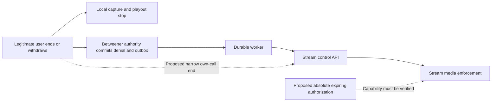

# Connect V1 M2C: consent revocation and active-media architecture decision

Date: 2026-10-30. Repository: `C:\Projects\betweener-app`. Scope: **architecture research, source/receipt inspection, abstract offline modelling and documentation only**.

**Recommend a hybrid with two distinct obligations: immediate denial at Betweener's authoritative admission boundary, and independently expiring authorization at the media enforcement boundary.** Preserve the existing authority/outbox design. Add a separately reviewed local safety shutdown and participant-authorized direct end path as complementary controls. Release still requires a verified provider-enforced absolute media deadline that cannot be extended or restarted using stale authority.

**No reviewed combination of currently established controls meets the complete outage/adversarial requirement. Keep real calls disabled.** A short Stream JWT, a database terminal flag, an end-job lease, an SDK leave callback or B3's observed termination is not an established active-media lease. The recommended target is conditional on provider capability verification; it is not a claim that Stream's current documented timer already implements that target.

Fallback: keep calling unavailable, including matched calling, if the required enforcement contract cannot be established. A different provider or owned media enforcement layer would then need a separate feasibility decision. Do not silently replace the requirement with cooperative-client safety or a matched-only release.

## 1. Evidence, scope and historical reconciliation

Reviewed Reports **18–32**, their relevant original receipts, current Connect migrations/Edge/worker/transport code, retained staging policy, installed SDK source and public official documentation. Source-backed findings below concern this checkout; they are **not** fresh hosted deployment/configuration attestations.

Before research, verified **73 B3 source hashes, 434 preparation/historical artifact hashes and ten hardened-classifier source/test hashes**. Snapshotted **2,394 existing repository files/absences**. All remain unchanged. The only new repository artifact is this report; ignored local evidence is under `tmp/connect-revocation-architecture-33/`.

| Reports / evidence | Meaning retained in this decision |
|---|---|
| [18](18-connect-v1-revocation-boundary-decision.md), [19](19-connect-v1-independent-forensic-audit.md) | Revocation can commit while the injected end-port exception prevents any end HTTP request. Held valid credentials then admit raw media. Earlier timer-ended observations retain received-counter growth; the provider-internal explanation is unknown. |
| [20](20-connect-v1-forensic-defect-remediation.md) | AD-1 call-level terminality and DB-1 admission rollback were repaired locally. Their old defects must not be reported as present in current source. Those repairs do not solve remote media revocation. |
| [21](21-connect-v1-media-truth-preparation.md)–[23](23-connect-v1-call-creation-400-audit.md) | Fresh-content methodology was prepared; B1 failed creation. A missing frame interval was confirmed against the pinned contract, without proving the historical server rejection rule. |
| [24](24-connect-v1-media-truth-b2-preparation.md)–[26](26-connect-v1-video-resolution-validation-audit.md) | B2 also failed before media. Complete resolution became the defensible setup correction; no media-security conclusion followed those 400s. |
| [27](27-live-vs-connect-architecture-comparison.md)–[29](29-connect-v1-media-truth-b3-execution-results.md) | Shared Video infrastructure is compatible historically. B3 created the corrected call and passed bidirectional controls, but both predeclared security verdicts were **INCONCLUSIVE**. |
| [30](30-connect-v1-b3-termination-classifier-audit.md)–[32](32-connect-v1-analytical-classifier-hardening.md) | Supplementary SFU termination/quiescence observations and the hardened offline tool do not replace historical verdicts or authorize runtime integration. No classifier development was performed here. |

Critical original SHA-256 values were rechecked:

```text
Report 18 raw boundary receipt:
8c1d82141a5c5140c94ac2b65e2b09dca42ebbe1f0f8c87b852d6dacdffa501d
B3 raw runner evidence:
0dcb9e021be24ae8cebf105938c11155a859013f619892f1663209149d077b55
B3 canonical execution wrapper:
ef7dd20af2b379003132d4ab4d3a2743cbd914a6525db6ef3f13a64425ce11f9
Report 32 hardening receipt:
164fa0914dcfeb1b4616ec96bfd889bc71d9ea6c4a9bffc30c5f6a6931fb6afb
```

B3's two SFU `callEnded` observations, clean signaling closures, flat final receiver tails and later transport failures are retained. Receiver B's extra **81 bytes / one packet** is retained. Report 18 retains **25,956/26,208 additional bytes and 103/104 packets** after ended metadata, of unknown generation age. B3's explicit end ACK occurred after transport failure and cannot explain earlier cessation. Neither historical experiment establishes a finite outage revocation guarantee. No receipt or consumed approval/ledger was changed or reused.

## 2. Security requirement and threat model

Define three separate moments:

1. **Local intent**: the user taps End, withdraws consent or blocks. Stop that legitimate device's capture/playout immediately, without awaiting a backend response.
2. **Authoritative revocation `R`**: the server commits the applicable consent/block/relationship/call-terminal change. Every subsequently authorized Betweener admission or renewal must deny it. A request that cannot commit during an outage is not a confirmed server-side block.
3. **Provider enforcement**: Stream stops accepting/forwarding the prohibited media and rejects unauthorized new sessions. A database commit, HTTP ACK, metadata field and observed packet plateau are different evidence.

The adversary may retain valid credentials, create new raw sessions/devices, bypass Betweener endpoints, ignore events/local cleanup/refresh, continue publishing and subscribing, and exploit stale workers or alternate token issuers. Trusted components are the authority, its signing keys and the selected provider's verified enforcement contract. No design here promises erasure of content already delivered or prevention of external recording. A participant's voluntary disconnect is not consent revocation of another participant's provider capabilities.

The required active-media property must cover **publication and reception, all sessions/devices and rejoin**, for both matched and pre-match calls. For a finite bound, product/security must separately approve a budget measured from `R`, covered faults, enforcement slack and clock assumptions. Experiment windows of 60/10 seconds are not release budgets. Instantaneous global revocation at the local tap during total communication failure is not a defensible distributed-systems requirement; truthful local protection and a preinstalled finite remote expiry must be specified separately.

| Case | New admission / authority requirement | Existing-media requirement and current limit |
|---|---|---|
| Normal voluntary end | Terminal call; no reopening old ID | Local shutdown first; durable provider end. Current remote maximum latency is not established. |
| Withdraw voice/video consent | Reject the revoked media authorization; invalidate affected active call | End the current call. A later voice-only call requires fresh applicable authority/acceptance; do not race an implicit video downgrade. |
| Block | Deny both directions after committed block; preserve moderation rules | Terminate all affected calls, with pending enforcement explicit. A Stream user-notification block is not the same operation. |
| Match/relationship authority revoked | Fresh checks reject lost mutual proof or revoked source | End affected calls. Existing membership does not disappear merely because relationship proof changed. |
| Normal duration limit | Do not issue/renew beyond the approved absolute end | Provider must enforce the deadline. Current product has no active duration cap; experimental timers are not a verified replacement. |
| Participant loses connectivity | Recovery/rejoin revalidates authority | Network loss is not evidence of provider revocation; the other participant/raw sessions may remain. |
| Supabase unavailable | Deny new admission/renewal; do not use cached eligibility as authority | Legitimate clients stop by their safety deadline; remote enforcement needs autonomous provider expiry. Current design lacks that bound. |
| Backend-to-Stream end fails | Commit denial and retain durable end work | Retry without claiming success. A direct participant request may supply another delivery path, subject to provider reachability and valid credentials. |
| Stream temporarily unavailable | Deny setup if it cannot be verified | Distinguish control-only failure with working SFUs from a media outage. The former is the difficult exposure case; do not assume all media dies. |
| Modified client ignores cleanup | Never issue authority based on its compliance | Provider must enforce; client timers/SDK teardown are insufficient. |
| Previously issued token remains valid | Betweener issuance denies after `R` | Direct provider admission remains a concern until provider-side denial/expiry; current membership can outlive consent. |
| Existing session stops refreshing | Refresh refusal must not be the only protection | Continuous forwarding must expire independently of client refresh. This property is not established for ordinary Stream JWTs. |
| Authorized user tries rejoin after revocation | No fresh credential/lease; old call generation stays terminal | Deny with held/new/alternate valid identity tokens, across first join, reconnect and new session. Current failure-path rejoin remains unresolved. |

Matched calls still require independently verified mutual authority, recipient media preferences and per-call acceptance. Pre-match calls additionally require **recipient-approved, directional, media-specific** grants tied to a valid source intent. Neither voice consent nor a match silently grants camera publication. Withdraw-current-call, disable-future-incoming-calls and revoke-pre-match-grant are distinct user actions.

## 3. Current architecture: what works and what does not

### Authority and admission

The foundation migration `supabase/migrations/20261028074908_connect_v1_foundation.sql` implements:

- `:90` current authenticated actor/account/moderation checks; `:115` current pair availability, recipient preference, independent mutual-match proof or directional/media-specific unexpired grant/source/revocation checks.
- `:268` pair/user serialization, payload-bound idempotency, server UUIDs and occupancy; `:298` recipient acceptance/device selection and versioned actions.
- `:255` grant revocation and affected terminal calls/end jobs in one transaction; `:492` block INSERT trigger marking affected calls terminal and queuing end. Relationship proof/block checks are in `20261028064220_relationship_acceptance_authority.sql:65`, `:86`, `:131`, `:534`.

The forward admission definition is **`20261029081013_connect_forensic_repair_1.sql:4`**, not the superseded foundation definition. It returns `admitted:false` normally after invalidation so terminal state/outbox work can commit. `supabase/functions/_shared/connect-credential-issuance.ts:17` requires affirmative, exact user/call/media admission both before issuance and afterward. `connect-credentials/index.ts:20` validates the authenticated user and supplies those two fences.

These are strong admission/transaction controls, backed by retained isolated tests and current source inspection. They do not form an atomic transaction with Stream. Promotion happens before the second fence. A racing revoke can suppress a new response without undoing membership or invalidating an older credential; a revoke after the last fence can also precede response delivery. Compensation needs eventual provider communication.

`rpc_connect_set_preferences` (`foundation.sql:194`) updates preferences; it is not a universal current-call revocation command. The eligibility predicate checks the **recipient's** media preference. Disabling a caller's incoming-call preference cannot be treated as immediate withdrawal from every call they initiated. Pre-match grant revoke has its explicit terminal/outbox path. Matched current-call withdrawal should use the call end path; lost relationship authority is rechecked by admission/get/snapshot/sweep. Those pull checks are not instantaneous provider notifications.

### Credentials, memberships and active expiry

The [adapter](../../supabase/functions/_shared/connect-stream-adapter.ts), `:35`, `:80`, `:97`, `:113`, verifies app identity/auth checks/type policy, exact pair/CID/custom binding and effective restrictions. It provisions invited read-only members, then promotes the pair after admission:

| Membership role | Exact current grants |
|---|---|
| `connect_invited` | `read-call` |
| `connect_voice` | `read-call`, `join-call`, `send-audio` |
| `connect_video` | Voice grants plus `send-video` |

Other configured global/generic role grants are empty under the checked contract. No current participant role has `end-call`, `join-ended-call`, settings/member/permission editing, screen capture or recording/egress rights. Policy assertions reject extra grants; any proposed participant end capability needs an explicit future policy/validator review.

Adapter `:122` generates an **ordinary user JWT**, `exp=mint time+120 seconds`, with an `iat` backdated 30 seconds. It has no call/device/consent-generation lease claims. The pinned server SDK preserves explicit `exp` (`src/StreamClient.ts:137`); `generateCallToken` (`:180`) simply forwards additional claims. App-device admission is therefore not cryptographic Stream device/session enforcement.

Public Stream authentication documentation describes expiring authentication, refresh and token revocation; call tokens can add call roles rather than restrict existing access. It supplies no finite active-RTP termination contract in the reviewed text. Supabase JWT/session controls govern Supabase authentication, not Stream's already admitted transport. [Stream authentication](https://getstream.io/docs/platform/authentication/), [Supabase sessions](https://supabase.com/docs/guides/auth/sessions).

The client implementation refreshes after an expired-authentication response (`node_modules/@stream-io/video-client/src/coordinator/connection/client.ts:529`, `token_manager.ts:101`). Coordinator join obtains separate SFU credentials (`Call.ts:1390`). A modified raw peer need not follow SDK refresh/cleanup. No inspected client code proves how Stream servers enforce expiry on an existing SFU session; that remains a provider contract question.

**There is no installed active-call duration policy.** `connect_transition` (`foundation.sql:144`) clears `deadline` on entry to ACTIVE; its 45/60/30-second ringing/connecting/reconnecting deadlines are not an active media lease. Adapter `:109` supplies only participant capacity and media-specific video settings, not `max_duration_seconds`. Retained `stream-staging-connect-validation.json:108` has maximum duration **null** and inactivity **30 seconds**. These retained settings are not a fresh app read.

### Termination delivery, ACK and reconciliation

The outbox survives call/account deletion, holds occupancy pending cleanup, fences job completion by lease and compensates late creates. End work is prioritized in `20261028143424_connect_m2a_revocation_cleanup.sql:4`. A **60-second worker claim lease** prevents competing work; it does not expire SFU authorization. Retry backoff is `min(300, 2^min(attempts,8))` seconds (`foundation.sql:435`), hence at most **256 seconds** for that expression, without a finite success deadline. Each worker invocation handles one claimed job; deployed scheduling/capacity/liveness was not attested here.

`connect-consent-revocation.ts:9` commits revoke first, attempts scoped end work, and returns `providerCleanup=pending` if not completed; the Edge returns 202. `connect-provider-worker.ts:13` requires provider completion followed by literal-true database job acknowledgement. Reconciliation now distinguishes permanent call end/missing call from transient session end (`adapter.ts:130`; forward SQL `:34`). Authenticated webhook events only wake reconciliation (`connect-webhook.ts:15`), never certify media cessation.

**Outstanding ACK precision issue:** `adapter.ts:126` treats any numerically coerced code **16** from end as idempotent success, without requiring HTTP 404. `media()` is stricter: code 16 **and** metadata status 404. This pre-existing asymmetry is confirmed by source, not a newly observed false provider ACK. A future end contract must preserve pending work on auth/timeouts/ambiguous responses, and distinguish accepted end, verified absence and measured enforcement. Do not release occupancy merely because an unqualified error was swallowed.

### Native ownership and local safety

`features/connect/media/stream-voice-transport.ts:29` is an injectable transport, with pre-join capture disabled, `join({create:false})`, identity-checked refresh, generation guards and local call retirement. It has **no installed real authenticated native factory**. `app/connect/voice-preview.tsx:9` mounts a fake preview; it is not a calling release.

`voice-controller.ts:128` attempts local leave before server end, but `endOnServer` catches network failures and local UI subsequently becomes ENDED. Polling errors at `:228` are ignored while SDK recovery owns transport state; there is no verified authority-silence shutdown budget. Transport cleanup also suppresses individual teardown errors. These are future UI/ownership requirements, not an installed fail-closed active lease. A local-ended screen must not be described as confirmed global secure termination.

## 4. Supported primitives and provider guarantee gaps

The installed versions remain server **0.7.63**, native **1.46.3**, web **1.44.0**, video client **1.62.0**, WebRTC **145.4.1**, Callingx **0.11.5**. Server source references below are relative to `%LOCALAPPDATA%/deno/npm/registry.npmjs.org/@stream-io/node-sdk/0.7.63/`; client references are under `node_modules/@stream-io/video-client/`. No package was installed or upgraded.

| Primitive | Documentation / pinned implementation | Supported conclusion and limit |
|---|---|---|
| End for everyone | Server `src/gen/video/CallApi.ts:168`, `VideoApi.ts:521`; client `src/Call.ts:3272` POST `/mark_ended` | Genuine control operation requiring `end-call`. Current backend uses the correct API. No numeric forwarding-stop bound follows from method existence. |
| Kick, optionally block | `CallApi.ts:162`; `models/index.ts:13565` has `block?:boolean` | Kick is distinct from permanent access denial. Requesting both is supported; all-device forwarding/time bounds require verification. |
| Call block / member removal | `CallApi.ts:108`, `:172`; `models/index.ts:24212` includes `remove_members` | Scoped access controls; removal alone is not proof that an existing subscriber transport has stopped. |
| Publish permission revoke | `CallApi.ts:393`; `models/index.ts:25454` | Audio/video publication controls exist. Removing send capability alone does not establish receive cutoff. |
| User/app token revocation | `models/index.ts` revocation fields; `gen/common/CommonApi.ts:1693` partial user updates and `:165` app revocation field | Authentication control with broader scope than a pair/call. Current SDK lacks the newer documented convenience methods named `revokeUserToken`/`revokeUsersToken`; do not paste those blindly. Existing-media kill semantics remain unverified. |
| Session max duration | `models/index.ts:13881`; call settings `:4289` | Configurable/extendable duration exists. Historical timer results do not certify a fault-independent absolute lease. |
| Empty-session inactivity | `models/index.ts:21993` | Ends an empty session, not an active hostile session or necessarily the call ID. |
| Single-use lifecycle | Public Calls API describes ended-ID denial even with ended-join privileges | Custom Connect lifecycle is **unknown** in retained normalized readback. The pinned `CallSettingsRequest` has no lifecycle field; no unsupported cast or built-in switch is justified. |

The reviewed official contract says end terminates a call, session timers remove users, and ended-call admission depends on permissions/lifecycle. Inactivity concerns the last participant leaving. None of these statements supplies the required maximum packet-enforcement slack or outage-independence proof. [Stream Calls API](https://getstream.io/video/docs/api/calls/).

The timer cookbook places its origin at **session start/first participant join** and permits extension. It is not documented there as an immutable deadline measured from Betweener authorization. [Stream session timers](https://getstream.io/video/docs/javascript/ui-cookbook/session-timers/).

Call moderation offers kick/block and publish-permission changes. General **user blocking** is separately documented for ringing/notification suppression; do not substitute it for active call termination. SDK end-event handlers call local leave (`src/events/call.ts:10`, `:37`), which cooperative clients obey and raw peers can ignore. [Stream moderation](https://getstream.io/video/docs/api/moderation/overview/), [client moderation](https://getstream.io/video/docs/react/guides/permissions-and-moderation/).

Minimum provider answers/evidence needed before selecting an enforceable release design:

1. **Active enforcement:** what stops both SFU acceptance and forwarding for every session/device after end/block/expiry, including non-cooperative peers? What is the maximum enforcement slack, not just event delivery behavior?
2. **Absolute deadline:** can authorization expire at a server-verifiable fixed time that survives delayed first join, disconnect, empty-session restart, reconnect, SFU migration/failover and an already connected peer avoiding refresh?
3. **Renewal fencing:** can stale/delayed/reordered renewals, old consent generations or another issuer extend that deadline? Expiry must be anchored to authorization time, not eventual delivery time.
4. **Failure independence:** does an SFU already possess and enforce expiry when Betweener, Supabase, Stream coordinator/control services or their network path cannot be reached? Which failures are excluded?
5. **Rejoin closure:** do held, newly minted ordinary, alternate-issuer and any call-role tokens remain denied for the terminated generation? Which lifecycle and role settings enforce that on this custom type?
6. **API-versus-SFU credentials:** what are the distinct expiry/revalidation rules for existing SFU credentials and identity JWTs? A refresh callback is not this answer.
7. **Intervention semantics:** is a successful end/block/kick ACK acceptance or completed enforcement; how is ambiguity reconciled? What exactly does call/session readback prove?

These are documented gaps in this review, not proof that no private/provider-supported solution exists. No support message or authenticated capability probe was sent. Public documentation was checked; Supabase's changelog/session guidance was consulted for the authority boundary, without querying a project.

## 5. Candidate decision matrix

“Strong” below is relative to the stated threat model, not a release certification. Costs are qualitative engineering/operational estimates, not provider price quotes.

| Candidate | Security strength / attack resistance | Dependency and native/Live implications | Complexity / cost | Required proof and residual risk |
|---|---|---|---|---|
| **A. Admission + durable termination** | Strong new-admission denial; eventual cleanup. Held access can persist while end is undelivered. | Depends on database, worker and provider delivery; preserves current Live isolation. Native still needs ownership. | Low incremental; queue/monitoring cost | Race, orphan, ambiguous ACK and worker-outage tests. No finite partition bound. Keep as foundation. |
| **B. Short JWT + refresh** | Limits one credential's later authentication; cannot certify active-media expiry. Modified peer can bypass app refresh. | Same-app alternate issuers complicate TTL claims; native refresh failures need honest UX. | Low/medium; more issuance/DB requests | Existing-session expiry and old/new/alternate token tests. Not the revocation enforcement mechanism. |
| **C. Provider max session duration** | Potential autonomous cap for one session, if enforced; first-join/reset gaps remain. | Provider timer behavior; no native enforcement substitute. Custom type can retain Live isolation. | Medium; interruption/replacement-call overhead | Written semantics plus strict hostile-peer/delay/restart tests. Historical failure/inconclusive evidence prevents certification now. |
| **D. Permissions/member removal, kick+block, end** | Useful immediate provider interventions; combine denial of new access with termination, rather than send-only mute. | All still traverse provider control. Keep mutations call-scoped; global bans/revocation can disrupt Live/other relationships. | Medium; more failure/partial-success states | All-session send/receive/rejoin testing and idempotent reconciliation. No partition bound alone. |
| **E. Verified expiring media authorization lease** | Target mechanism for bounded exposure despite absent revocation delivery. Reject stale generations and enforce locally at the forwarding boundary. | Requires a **verified provider capability** or different enforcement architecture; unavailable authority stops renewal. Native must not control enforcement. | High/unknown until capability established; renewal traffic and availability tradeoff | Absolute expiry, all paths, clock/slack and failure-independence contract. Not established in current SDK/docs/evidence. |
| **F. Fail-closed legitimate client + reconciliation** | Protects that user's future capture/playout; modified peers ignore it. | Works locally without backend ACK; background/OS interruptions and teardown failures need explicit handling. No Live-client disconnect collateral. | Medium; privacy/UX/native testing | Real iOS/Android capture shutdown and authority-silence tests. Cannot certify hostile-peer global termination. |
| **G. Dedicated app/type isolation** | Reduces alternate issuers/global-role blast radius. Does not revoke an already admitted peer by itself. | Existing custom type is appropriate. Separate app adds secrets, identity/device/push ownership and separate client cache keys. | Medium/high operational scope | Former-member alternate-token tests, app/type readback and native coexistence. No standalone active cutoff. |
| **H. Hybrid A+B+D+F, with E as release condition** | Best division of authority, immediate response, eventual repair and bounded fallback **if E is verified**. | Retain custom type; scoped independent end delivery; local lease expiry must survive control outage. | Medium now; potentially high lease work | Every constituent fault and combined race; without E it retains the unbounded outage gap. **Recommended target.** |
| **I. Participant-authorized direct own-call end** | Bypasses an unavailable backend path when a legitimate participant can reach Stream; no need for the malicious peer to cooperate. | Existing client API supports it, but current grants forbid it. Needs narrowly reviewed `end-call` in admitted membership roles, not global admin/settings powers. | Small API/policy delta; nontrivial native/ACK UX | Own-call scope and no escalation; expired credentials and Stream control outage still defeat delivery. Useful complement, not E. |

Other supported authentication/ban/deactivation operations are not routine pair-consent controls: their scope can affect the user's unrelated Live participation and other relationships. They still require provider delivery and do not supply an inspected finite active-media guarantee. Merely muting, emitting a custom event or waiting for an empty-session timeout is insufficient. Changing JWT shape to a call token is not a safe lease shortcut. Encryption/key rotation is not a substitute for provider enforcement against peers that retain keys or refuse to rotate; no such enforcement integration is established here.

## 6. Exposure analysis

Let `R` be committed authoritative revocation; `d_b` the delay until a backend end actually reaches and is accepted by Stream; `d_c` the corresponding independent participant-request delay; and `e` a verified enforcement slack. None has an established numeric upper bound today. **Unknown is not zero**, and a retry backoff interval is not a delivery bound.

| Candidate | Normal operation | Delayed provider termination | Backend-to-provider completely unavailable | Existing publishing/receiving, rejoin and bypass |
|---|---|---|---|---|
| A | Ends after successful control/enforcement; no verified maximum | Conditional `d_b+e`; both unbounded in current evidence | No finite upper bound established | Both media directions can remain; direct old-token rejoin remains possible until provider state changes. |
| B | Same active-media limit as A; one Connect JWT expires about 120 seconds after mint | No established active-media ceiling | No established ceiling for a connected peer | Expiry can reject a new authentication with that token. It does not prove a current stream stops; other valid issuers defeat a Connect-only TTL assumption. |
| C | For a started, immutable, actually enforced timer: `max(0,S+M-R)+e` | Could cap that session if configured before failure and expiry independent | Same conditional session cap; **unverified** here | Delayed first join adds waiting time; restart/reset and stale extensions require proof. No general absolute revocation bound established. |
| D | Scoped operations improve prompt enforcement when accepted | Requires delivery and complete intervention semantics | No finite upper bound established | Publish revoke alone leaves reception unresolved; kick alone permits rejoin. Block/end plus least privilege address admission if delivered. |
| E | End can act earlier; otherwise absolute lease expires | At most `L+e`, **only under the contract below** | Same conditional bound without new control delivery | Must expire both media directions and every session/rejoin regardless of identity JWT validity or client behavior. Not currently verified. |
| F | Local capture/playout stops after actual device teardown; no asserted numeric maximum | Local protection can occur before remote ACK | Legitimate local protection remains possible | A hostile peer can ignore it. No global provider bound; already delivered data cannot be recalled. |
| G | Same as the underlying enforcement mechanism | Same | Same | Helps cross-issuer/rejoin isolation, not existing-media expiry. |
| H | Earliest working end path, with E's fallback if established | Conditional minimum of successful intervention and absolute expiry | E needed for the finite fallback; without it no finite bound | No automatic security PASS from combining controls that all lack an independent expiry. |
| I | Conditional `d_c+e`, or earlier backend success | Can improve delivery if only backend path failed | May work if participant-to-Stream still works and JWT is valid; otherwise no bound | Local cleanup can be ignored by attacker, but accepted provider end is a separate intervention. Expired credentials or shared provider ingress failure remove this path. |

### Necessary lease contract, not an implemented Stream feature

Suppose a permit authorized at authority time `A` has fixed absolute expiry `D <= A+L`. No permit may be authorized after `R` for the revoked generation. The media gate rejects expired permits and never resets `D` on arrival, first join, reconnect or session replacement. Then `A <= R` implies residual authorization no later than **`R+L+e`**, where `e` explicitly includes the allowed authority/provider clock and enforcement uncertainty.

This is a **conditional architecture proof**, not a measured Stream guarantee. A pre-revocation renewal delayed in transit must retain its original absolute expiry. If the provider instead starts a fresh `L` on eventual receipt, arbitrary network delay can arbitrarily extend exposure. A server scheduler that keeps sending relative timer extensions without fencing is therefore not a lease implementation. Epoch checks must protect renewal authorization, compensation and old-job replay; do not assume the provider accepts or enforces such epochs today.

The security metric is the enforcement of **new prohibited media acceptance/forwarding**, not when an adversary later replays content already received. Receiver arrival, jitter buffering, playout and packet generation have different timestamps; no finite Internet delivery-delay assumption is smuggled into `e`. Tests need fresh post-trigger content and independent remote observation, while provider-side guarantees must supply the all-path enforcement property that finite observations alone cannot prove.

Twelve abstract offline cases cover admission denial, authority outage, held/expired/alternate credentials, non-cooperation, lack of an autonomous transition, independent end delivery and delayed-renewal counterexamples. The absolute-expiry model was checked across varying revocation/authorization/delivery times. All **12 model assertions passed** under their stated assumptions (`architecture-model.json`). These are not a provider simulator, physical media tests or new security acceptance evidence. In particular, continuation is **not excluded by the model**; the model does not claim Stream necessarily forwards forever.

## 7. Recommended architecture and safety experience

Retain server-owned unique call IDs, exact pair membership, invitation before admission, independent match/grant checks, separate media consent, both credential fences, durable outbox/occupancy and terminal-absorbing reconciliation. Keep capture, recording, screens, transcription and egress restrictions. A new relationship/grant never reopens an old terminal call generation.

For future reviewed work, add these controls in order of responsibility:

1. **Local safety owner:** stop camera/mic/publication, leave receive transports and stop local playout immediately on End/withdraw/block, invalid authority or safety-deadline expiry. Cancel refresh/rejoin and retire the local call generation. Verify teardown rather than equating swallowed errors with stopped hardware. Keep this independent of remote ACK.
2. **Authoritative end intent:** serialize the correct matched/pre-match/pair/media change, terminal state and durable end obligation together. Treat match loss, blocking and account moderation with the same generation discipline. Preserve pending status through ambiguous delivery, stale completion and outages; add service liveness/backlog alarms rather than treating retry creation as enforcement.
3. **Two delivery paths where justified:** backend control remains primary. Evaluate giving admitted call-members only `end-call` so either legitimate participant can send the existing direct end request when backend delivery fails. Both participants already have the product right to end their own conversation; this adds no video, recording, create/update or other-call access. This is a **proposed policy change**, rejected by today's strict role validator until separately reviewed. Do not wait for Supabase before attempting local safety shutdown. If a direct ACK is received while Supabase is unavailable, retain a scoped end intent/receipt for later authenticated reconciliation; do not trust an arbitrary client claim of remote enforcement.
4. **Call-scoped revocation/rejoin closure:** evaluate end plus explicit block/kick/member cleanup as idempotent interventions, with clear partial-success states. Avoid global token revocation or user bans for an ordinary pair block. Never re-promote a revoked generation while reconciling.
5. **Provider-enforced expiry:** require E's verified absolute ceiling before release. Authority outage prevents renewal; existing issued leases expire at the gate. An alternate issuer, device or delayed first join cannot escape it. Short JWTs remain defense in depth, not this mechanism.



The two arrows into Stream control improve delivery diversity; they do not make Stream control itself independent. The expiry mechanism must already be enforceable at the media boundary if both arrows fail.

Local shutdown is a concrete privacy control for an honest withdrawing participant: the other peer cannot receive new capture from a device whose publisher has actually stopped. It should happen even when remote termination cannot be confirmed. That narrower protection does not cover another still-publishing device, a modified source, or server-initiated revocation that neither client has learned about; those are why the provider enforcement requirement remains separate.

### Truthful UI and native lifecycle

Represent at least **local media stopped**, **authoritative revocation committed/pending**, and **provider end acknowledged/pending** separately. Do not name a control ACK “secure media cutoff verified.” Suggested copy after successful local teardown: “Your microphone and camera are off. Ending the connection…” For confirmed server block with remote cleanup pending: “Blocked in Betweener. Connection shutdown is pending.” If the block could not commit: “Your local call has stopped. Blocking has not yet been confirmed—retry when connected.” Do not falsely confirm revocation persistence during a Supabase outage.

Do not display “microphone off” after an unverified teardown failure. End the local OS call UI promptly and expose unresolved app/backend status separately; keeping an OS microphone/call session open while awaiting remote ACK is unsafe UX. A disconnected/failed PeerConnection is not an explanation of its cause.

iOS CallKit/AVAudioSession and Android Telecom/foreground audio ownership need a single authenticated owner, logout/account-switch cancellation, route/interruption/background handling, explicit publication consent and verified resource release. Resume/reconnect must revalidate current authority and cannot automatically restore video. Existing Connect preview/transport abstractions do not validate these device paths. No native integration is authorized here.

### Live compatibility and isolation choice

Retained evidence places Live and Connect in Stream app **1731011**; current deployed secret values were not read. Live's current token issuers use ordinary provider identities with additional call claims: `live-rtc-token/index.ts:221` uses 600 seconds and `live-studio-media-token/index.ts:172` uses 300 seconds. A formerly admitted Connect member holding another valid same-app credential is an **unclosed threat**, not a newly reproduced bypass; the old outsider Live-token negative does not test that subject.

Keep `betweener_connect`; do not copy Live or built-in `default`/`audio_call` grants. Their useful lifecycle/defaults do not substitute for Connect consent. A dedicated application, or a separately designed Connect identity/issuer namespace, may be required if same-app alternate-issuer access cannot be eliminated. That would improve isolation, not repair undelivered termination. Global revocation in the shared app could disrupt Live; it is not the minimum pair-consent response.

The client singleton is keyed by API key/user (`StreamVideoClient.ts:127`); Live's lease registry retains the first factory (`features/live/media/stream-video-client-leases.ts:20`). Any future shared auth owner must avoid a Live-only refresh closure or disconnecting a Live client's remaining lease. A separate app changes that cache key but introduces its own device/push/client lifecycle work. No Live source/settings or issuer was changed.

## 8. Alternatives not sufficient for release

- **Admission/outbox alone:** necessary correctness; no finite delivery guarantee through a partition.
- **JWT expiry/forced app refresh alone:** authentication control cannot be promoted to an active media lease; an attacker need not request another app token.
- **Unverified short timer or rolling extensions:** no established enforcement slack, absolute origin or restart/late-renewal fence. B3 success does not erase Report 18's failure.
- **SDK leave, mute or event handling alone:** protects cooperating local paths, not raw peers. Revoking send alone does not establish receive denial.
- **Matched-only rollout:** reduces pre-match policy surface, but blocking, safety moderation, relationship loss and voluntary call end still require active-media enforcement.
- **Built-in type, another app, shorter retry schedule or extra worker alone:** changes policy/isolation/availability; none supplies the missing autonomous media expiry.
- **Universal guarantees from finite tests:** independent media tests can disprove a claimed bound and corroborate a measured window; they cannot alone certify every provider failure mode.

## 9. M2C work packages, acceptance and rollback

All packages below are **proposed future scopes, NOT AUTHORISED by this task**. No additional Media Truth execution or diagnostic/classifier extension is the next step.

| Package | Narrow scope | Measurable acceptance / stop condition |
|---|---|---|
| **M2C-0: requirement and offline contracts** | Approve the exposure budget/fault scope; design end-intent/generation/ACK states, exact error handling, local privacy status and direct-end grant diff. Model renewal/revoke ordering. | One explicit definition of `R`, `L`, `e`, all-session scope and authority-outage behavior. Ordinary unit/model cases cover both admission fences, late issue/create/renew, duplicate intent, wrong user/call/device/media, ambiguous ACK/code16, terminal absorption and pending occupancy. No unknown fact defaults to success. No runtime integration. |
| **M2C-1: provider capability verification** | Obtain a precise supported contract for active expiry/end/rejoin and verify SDK/configuration compatibility on paper first. Prepare scoped verification only if the contract can meet the budget. | Written/authoritative answers to section 4 gaps; exact supported fields and readback expectations; all-path expiry and a numeric bound consistent with the approved budget. If unavailable/undocumented, stop and retain disabled fallback. No speculative setting casts, built-in switch or silent SDK upgrade. |
| **M2C-2: separately approved security fault tests** | After capability and owner approval, test the enforcement architecture, not more classifier categories. Use isolated staging ownership, original immutable evidence and existing non-cooperative measurement requirements. | Each direction has positive independent controls. Test dropped/delayed/lost-ACK end, backend isolation, authority outage, expired API token with live SFU, ignored cleanup, simultaneous sessions/devices, valid old/alternate tokens, delayed first join/restart, reordered renewals and SFU failover where supported. No qualified fresh delivery beyond the approved bound; incomplete evidence blocks acceptance. Ordinary clients cannot extend/disable/recreate/escalate. Scope/provider outage classes must be truthful. New approval/IDs only; never reuse consumed B3. |
| **M2C-3: native integration** | Only after the enforcement gate: install authenticated Connect ownership and scoped local shutdown, authoritative refresh and proposed end delivery. | Real iOS/Android tests cover background/foreground, interruptions, denied permissions, account switch/logout, revoked-consent return, CallKit/Telecom hangup, lost network, process loss and teardown failure. Capture/playout checks pass; no automatic video upgrade; Live ownership/refresh/push remain isolated. |
| **M2C-4: release readiness** | Separate reviewed deployment/configuration/build provenance, policy and operational readiness. | Current hosted authority/config matches reviewed hashes; scheduler capacity/alerts and reconciler recovery proven; all security blockers closed by their owners; both Live test selections accounted for; product approves truthful pending/outage UX and residual exposure. No release or gate change follows this document automatically. |

Failure/rollback conditions: any unauthorized admission, fresh prohibited media beyond the approved bound, reset/late-renewal escape, missing provider contract, ambiguous intervention treated as done, uncontrolled alternate issuer, unverified hardware shutdown or incomplete required evidence blocks advancement. Stop new calls/renewals, stop legitimate local media, preserve end obligations and exact audit evidence, attempt scoped cleanup when available, and retain pending occupancy until valid completion. **A feature-flag rollback is not remote termination of existing hostile sessions**; only a verified preinstalled expiry or successful enforcement operation supplies that fallback. Do not reopen terminal IDs or discard ledgers to clear a queue.

## 10. Exact Live baseline reconciliation

The four-versus-five difference is **test selection**, not a demonstrated fix or regression between Reports 27/28 and 32. Current source and historical logs support this, and fresh offline runs here reproduce it:

| Selection | Exact command/selection | Historical evidence | Fresh result |
|---|---|---|---|
| Package script, **56 files** | `npm.cmd run test:live-logic`; the exact Node arguments are the current `package.json` script | Report 18's 508-test baseline; Report 32 `tmp/connect-analytical-hardening-32/live-before.log` / `live-after.log` | **508 tests: 504 pass, 4 fail, 0 TODO; exit 1** |
| Expanded Live audit, **60 files** | Node with `--no-warnings=MODULE_TYPELESS_PACKAGE_JSON --experimental-strip-types --test`, explicitly supplying sorted `__tests__/live-*.regression.test.ts` files | Reports 27/28; `tmp/connect-live-comparison-27/live-before-summary.json` and B3 preparation `live-before-summary.json` | **514 tests: 509 pass, 5 fail, 0 TODO; exit 1** |

Fresh command argument/file arrays are retained in `tmp/connect-revocation-architecture-33/live-commands.json`; logs are `live-package.log` and `live-expanded.log`. The package selection was executed with its identical explicit Node flags/file list. Reproduce the expanded selection in PowerShell:

```powershell
$liveAuditFiles = @(Get-ChildItem -LiteralPath __tests__ -Filter 'live-*.regression.test.ts' | Sort-Object Name | ForEach-Object { $_.FullName })
node --no-warnings=MODULE_TYPELESS_PACKAGE_JSON --experimental-strip-types --test @liveAuditFiles
```

| Exact failing test | Source | Package / expanded |
|---|---|---|
| `Live catalogue waits for real auth and reloads after auth recovery` | `__tests__/live-auth-recovery.regression.test.ts:121` | Both |
| `screen-only Program output follows the selected canvas and offers a focused view` | `__tests__/live-fullscreen-stage.regression.test.ts:229` | Both |
| `audience Program output exposes no Studio access or private matching data` | `__tests__/live-phase10g-studio-database.regression.test.ts:271` | Both |
| `standard Room Pulse keeps a curated, readable note preview` | `__tests__/live-room-safety.regression.test.ts:96` | Both |
| `credential refresh first proves the active compositor lease` | `__tests__/live-phase-c2-compositor.regression.test.ts:29` | **Expanded only** |

The selections are not nested. Expanded includes nine files omitted by the script: `live-audience-policy`, `live-creation-draft`, `live-operator-grade-studio-phase-b`, `live-phase-c-broadcast-database`, `live-phase-c-broadcast-domain`, `live-phase-c2-compositor`, `live-product-release-gate`, `live-studio-on-air-team`, `live-studio-operator-assignment` (each `__tests__/<name>.regression.test.ts`). Package instead includes `stream-live-media-provider`, `circle-dating-experience`, `circle-access`, `push-notification-security`, `push-notification-compatibility`. The net difference is six executed cases, not six assertions solely from the compositor file. The compositor file itself contains six tests, with one failure.

The fifth test expects the old `_v1` snapshot name. Current orchestrator `supabase/functions/live-broadcast-orchestrator/index.ts:119` uses `_v2`; separately, its argument at `:123` is `p_lease_generation` while the repository `_v2` definition uses `p_expected_lease_generation` (`20261025190010_screen_presentation_fit_v1.sql:93`). This retained static RPC mismatch remains independent of Connect's provider-only experiments; a failed old-name assertion alone does not establish deployed behavior. No Live fix, hosted RPC or configuration change was made. **Neither Live suite is green.**

## 11. Validation, preservation and final decision

This was a decision exercise. The 12 abstract model checks and two existing pure/offline Live selections were executed; no Connect security suite, browser media, SQL driver, hosted endpoint, provider experiment, native device or build was run. Report 32's 84/84 analytical and 290/290 Media Truth results remain historical validation, not new enforcement tests. Public documentation browsing is separate from authenticated service access.

All **2,394 baseline repository entries** and **517 protected source/artifact records** remain unchanged, including Reports 18–32, current product/runtime files, the original/hardened offline classifiers, all prepared B3 sources/artifacts and consumed execution records. No source repair, shared database access/mutation, migration, deployment, OTA, production change, Live modification, native integration or calling enablement occurred. No provider support communication or execution approval was authored.

The smallest defensible next action is **M2C-0 plus paper capability clarification for M2C-1**, after separately authorizing that work. Prioritize the absolute media-enforcement contract and honest end/ACK states; do not spend another experiment extending diagnostics or claim that token refresh closes the active-media gap. If Stream cannot support the required absolute, fault-independent enforcement ceiling, the safe product decision remains **calling disabled**.

```text
CONNECT_REVOCATION_ARCHITECTURE = RECOMMENDED
CONNECT_FINITE_REVOCATION_BOUND = UNVERIFIED
CONNECT_PROVIDER_CAPABILITY_GAPS = DOCUMENTED
CONNECT_M2C_IMPLEMENTATION = NOT_AUTHORISED
CONNECT_M2A_SECURITY_GATE = BLOCKED
CONNECT_M2B_READY = BLOCKED
PROVIDER_WRITES = NONE
PRODUCTION_MODIFICATIONS = NONE
```

RECOMMENDED identifies a conditional target architecture, not an available verified Stream release configuration. UNVERIFIED means **no finite hostile-peer bound is currently established**; it is not a claim that a provider-supported capability cannot exist. Original B3 remains **INCONCLUSIVE**, Report 18's security failure remains recorded, and the hardened analytical classifier stays offline.
