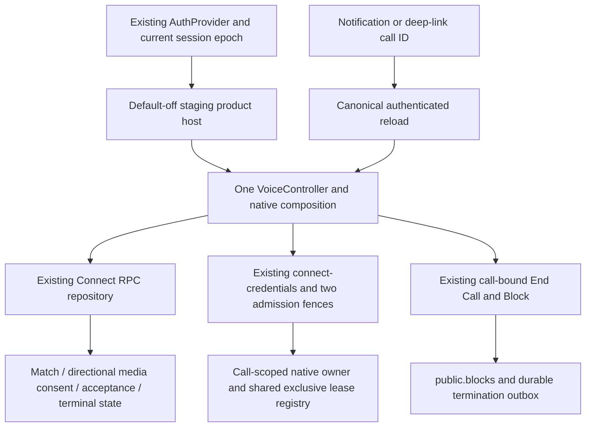

# Connect V1 M3: native product integration

Date: 2026-10-31. Scope: local app implementation, offline tests and disposable local database validation. **Voice product composition is implemented locally and mounted behind default-off staging gates. No authenticated hosted operation, device test, migration deployment, build, installation or OTA publication occurred.**

The standalone device harness is deferred by the owner. It was not extended or launched. The next device environment is the Betweener staging development app, after compatibility checks and separate execution approval. Original experimental results, including Report 18's negative finding and B3's INCONCLUSIVE verdict, remain unchanged. No finite remote revocation bound is established.

## Dependency map and reused authority



Reviewed Reports 33–35 and 37–40 and the current implementation; Report 36 is absent. Report 43's internal view/controller binding is reused. No second block store, call authority, token issuer, provider worker, navigation root or media-client registry was introduced. No new migration or Edge function is required by this client milestone.

## Exact implementation files

The table lists changes against the pre-M3 worktree, including pre-existing uncommitted Connect files. Historical documents and the existing Report 42 device guide are preserved.

| File | Status |
|---|---|
| `__tests__/auth-session-transport.interaction.test.ts` | Modified |
| `__tests__/connect-notification-contract.regression.test.cjs` | New |
| `__tests__/connect-product-integration.regression.test.cjs` | New |
| `__tests__/connect-product.interaction.test.tsx` | New |
| `__tests__/fixtures/connect-product-fixture.cjs` | New |
| `app/_layout.tsx` | Modified |
| `app/connect/_layout.tsx` | New |
| `app/connect/index.tsx` | New |
| `app/connect/video.tsx` | New |
| `app/connect/voice.tsx` | New |
| `components/chat/ChatScreen.tsx` | Modified |
| `features/connect/application/product-coordinator.ts` | New |
| `features/connect/components/ConnectCallEntry.tsx` | New |
| `features/connect/components/ConnectIncomingNotice.tsx` | New |
| `features/connect/components/ConnectProductProvider.tsx` | New |
| `features/connect/components/ConnectStatusScreen.tsx` | New |
| `features/connect/components/ConnectVoiceSession.tsx` | Modified |
| `features/connect/components/VideoCallPreparation.tsx` | New |
| `features/connect/components/VoiceCallControls.tsx` | Modified |
| `features/connect/components/VoiceCallLobby.tsx` | New |
| `features/connect/components/VoiceCallScreen.tsx` | Modified |
| `features/connect/config/connect-runtime-policy.ts` | New |
| `features/connect/data/authenticated-connect-services.ts` | New |
| `features/connect/data/load-connect-product.ts` | New |
| `features/connect/data/voice-api.ts` | New |
| `features/connect/data/voice-service.ts` | Modified |
| `features/connect/domain/call-navigation.ts` | New |
| `features/connect/domain/video-preparation.ts` | New |
| `features/connect/media/connect-native-owner.ts` | Modified |
| `features/connect/media/native-capture-tracks.ts` | New |
| `features/connect/media/native-safety-composition.ts` | Modified |
| `features/connect/media/native-stream-sdk.ts` | Modified |
| `features/connect/voice/call-presentation.ts` | New |
| `features/connect/voice/voice-controller.ts` | Modified |
| `features/connect/voice/voice-safety-status.ts` | Modified |
| `features/connect/voice/voice-types.ts` | Modified |
| `lib/auth-context.tsx` | Modified |
| `lib/auth/native-session-owner.ts` | New |
| `lib/auth/session-token.ts` | Modified |
| `lib/notifications/installation-id.ts` | New |
| `lib/notifications/notification-routing.ts` | Modified |
| `lib/notifications/push.ts` | Modified |

This report and `connect-v1-m3-staging-readiness.json` are additional new documentation artifacts. Source hashes, exact test selections, logs and preservation results are retained under `tmp/connect-native-product-m3/`.

## Authenticated native integration

`ConnectProductProvider` is inside the existing `AuthProvider`, outside screen lifetime. Its default-off path does not load Connect services, subscribe to Auth, poll, request permissions or create a Stream client. Root Auth processing only supplies an inert local session fence while calling is disabled.

The native session fence is fed by existing Auth SDK events and explicit sign-out intent. It requires coherent user/session identity and a usable expiry, uses a stable epoch through normal token refresh, retires on logout/account/session change, and rejects retired-session replay. It performs no online token verification and grants no admission. Profile ID/account binding, authenticated-write readiness and absence of persisted-session fallback are checked before product bootstrap. A failed or retired session requires fresh eligible Auth before a new owner can be created.

Each RPC, profile read and credential request carries an explicitly captured bearer on that request, with epoch checks before dispatch and after completion. Shared Supabase Auth headers are not mutated. The installed PostgREST `setHeader` implementation clones request headers; the existing Edge invocation accepts per-request headers. Late operations cannot silently use another account's current bearer. This preserves the existing synchronous/queued Auth event arrangement described by the [Supabase Auth event documentation](https://supabase.com/docs/reference/javascript/auth-onauthstatechange).

The server still authenticates JWTs, verifies current mutual proof or recipient-approved directional/media-specific consent, selects the accepting device and owns transitions. Client eligibility reads are advisory preflight. Create/accept and the two credential fences must independently authorize the action. Navigation parameters and notification content cannot mint consent or credentials.

The host checks the **native** application ID from Expo Application, staging variant/environment, the exact staging Supabase origin, native platform and development mode. Both new product switches and the existing native-owner switch must be explicitly reviewed and enabled later. Checked-in `connectProductPolicy.ui`, `nativeRuntime`, `videoTransport`, `connectFeatureFlags.nativeSafetyOwner` and `endCallAndBlock` remain false. An environment variable, URL or push payload cannot turn them on.

Connect retains its own refresh callback and exact server-issued call identity. The shared registry rejects native ownership while Live is active or quarantined and never disconnects a Live lease to make space. Push registration and Connect reuse the existing SecureStore installation ID; concurrent lookup now shares one pending operation per app variant.

The product selects conservative local recovery: native reconnect/migration/offline transitions retire this owner; foreground cannot resume it. A failed canonical authority read also starts local shutdown and authoritative end independently. A new call must use fresh authority and a new generation. These are cooperative app controls, not a provider-enforced hostile-peer lease. The [Stream lifecycle documentation](https://getstream.io/video/docs/react-native/guides/calling-state-and-lifecycle/) describes transport lifecycle; it does not supply the missing remote revocation guarantee.

The app's `supabase.rpc()` facade is Promise-wrapped. Connect uses the **same data client's** `schema('public').rpc()` builder to pin the bearer, with an intercepted real-SDK regression. It preserves the existing development facade's 12-second UI request budget and aborts a timed-out request. This is an HTTP/UI budget, not an authorization lifetime or media-enforcement bound; timeout cannot prove that a server write did not commit. Unknown outcomes remain unconfirmed and use the existing reconciliation/idempotency rules.

## Voice screens and interactions

| Surface | Implemented local behavior |
|---|---|
| Conversation entry | Default-off chat header action. Uses the existing peer profile ID, hides for locally blocked/deleted peers, and opens a server-checked lobby. Local match presentation never authorizes the call. |
| Outgoing lobby | Canonical name/avatar, permission-check state, explicit Voice call action and cancellation. No create request on render, navigation or eligibility success alone. Pre-match routes require an explicit grant ID and a fresh server eligibility check. |
| Outgoing invitation | Connecting/ringing presentation, recipient identity, Cancel, safe errors and authoritative setup deadlines. Duplicate taps share the controller's in-flight request/key. No native audio is acquired merely because a call is ringing. |
| Incoming invitation | Foreground canonical discovery/notice or authenticated call-ID reload. Separate Accept and Decline. No permission request, credential issue or microphone capture on notification arrival or screen mount. Acceptance is recipient-only at the existing RPC. |
| Active call | Participant identity, duration derived from server connection time, mute, supported earpiece/speaker/Bluetooth/wired outputs and connection/reconnecting state. Routing uses SDK device IDs/readback. No fabricated numeric network-quality score. |
| End | Starts local teardown and server end independently, including when leave hangs. Server terminality, local cleanup and unavailable provider confirmation remain separate. |
| End Call & Block | Existing call-bound preparation/command/status path and explicit generation-bound confirmation. Failed local leave cannot prevent block submission. A lost/ambiguous block response is not shown as saved; status checks do not recreate a later unblocked row. |
| Completion/history | Missed, declined, cancelled, blocked/revoked and unavailable-call presentation. An already answered invitation does not take over or terminate another device's call. Account/epoch-bound view data cannot carry into another login. |

The presentation reuses Betweener typography, teal, restrained purple and neutral palette. Connection state is not a hardware or remote-enforcement assurance. Pending/failed local cleanup remains visible outside the call route. The real provider ACK remains available through the existing block receipt; ordinary terminal metadata does not invent that ACK.

Navigation cleanup uses the existing CID binding or a captured controller generation. Opening an unrelated notification cannot claim cleanup of an already active call. The global host owns polling and disposal; route views do not create competing native owners.

## Native cleanup and device limitations

Connect's SDK boundary now retains stable local capture handles and submits stream detachment/disposal while native tracks are still valid, before individual track disposal. This addresses the Android disposed-track failure class found in the deferred harness. Later SDK cleanup observes an empty stream, and repeated owner cleanup does not dispose a track twice. Failed/ambiguous detachment stays unconfirmed and quarantined. No SDK package/native source or Live implementation was patched.

The owner separately observes local tracks, publishing, subscriber/playout, leave, client release and lifecycle operations. These remain SDK/bridge observations. **No microphone samples, camera frames, speaker cessation, native factory release or integrated physical calling have been verified by this milestone.** The previous failed device run is not relabelled.

Current product calls retire on background/inactive/Android blur. No automatic media restart is implemented. Android audio-focus-only events, real route changes, interrupted native cleanup and SDK automatic-rejoin cancellation require integrated device evidence. SDK-internal peer disposal remains an upgrade-sensitive boundary.

## Notifications, deep links and pre-match readiness

The existing notification router prepares six call-ID-only contracts: incoming voice, missed, cancelled, expired, revoked and blocked. Unknown/malformed Connect payloads and generic Connect route overrides are rejected. Only navigation taps are accepted; a notification answer action is not executed. Tokens, API keys, claimed acceptance, names and avatars are not forwarded or persisted by the call route builder.

The canonical API determines what a tapped call now means. Late missed/cancelled/revoked notifications cannot recreate the call. An unauthorized call ID produces a bounded unavailable state. Existing deferred navigation infrastructure is reused.

**Foreground incoming flow is implemented locally. Background/killed-app delivery is incomplete.** No canonical Connect push producer, delivery allowlist update, push category, CallKit/Telecom service or entitlement/configuration was deployed or registered. The readiness manifest calls out that separate work. Current behavior must not be advertised as reliable background ringing.

Matched conversation entry is mounted. Pre-match launch and server validation support a canonical approved voice grant; `ConnectCallEntry` accepts that grant from a trusted future Intent host. The existing Intent screen does not yet expose a complete voice-grant request/approval/revocation interface or discover such a grant for a call button. No grant is inferred from an accepted text Intent Request. That remaining product integration must reuse the existing grant RPCs and media-specific authority.

## Video preparation

The in-app video route, typed preparation state and reusable screen include camera-off/approved-preview slots, permission/consent/failure messages, prepared camera-switch and microphone controls, and reuse of the same call-bound safety panel/End action interface. Real camera/microphone controls are disabled on this route. It imports no video transport, creates no camera owner and issues no video credentials.

Even an approved UI model cannot enable video transport/publication. Voice authority never escalates into video. A future video implementation requires fresh explicit recipient approval, independent camera permission, server-issued VIDEO admission and reviewed native ownership. The preview slot is a presentation interface, not a source of consent or a physical camera test.

## Fresh validation

| Check | Fresh result / limit |
|---|---|
| Current Connect/media/relationship, native ownership, product, notification and selected Live regressions | **635/635 PASS**, 36 unique files, zero failures/skips/TODOs; offline-accepted.log. Includes 54 product cases and three new notification contract cases. |
| Connect presentation/navigation interactions | **27/27 PASS**, three Jest files, ui-frozen.log. Native/services are doubles. |
| Shared Auth/session/storage/callback regressions | **20/20 PASS**, four Jest files, normal exit0; auth-complete.log retains a delayed-exit warning. |
| Disposable PostgreSQL/loopback REST | **22/22 PASS**, plus **88/88** prerequisite relationship assertions; disposable-database.log. Resources removed. Provider effects mocked. |
| Full app TypeScript | PASS, exit0; typescript-accepted.log. No app/native build. |
| Targeted lint | PASS for42 source/test files, zero warnings; lint-accepted.log. |
| Live and EAS environment isolation | Both PASS; live-isolation.log / eas-isolation.log. No hosted reads or changes. |

Exact Node selection: `tmp/connect-native-product-m3/test-selection.json`; exact lint selection: `lint-complete-selection.json`. Node used `node --no-warnings=MODULE_TYPELESS_PACKAGE_JSON --experimental-strip-types --test --test-reporter=tap` with that unique file list and **child-process-only** `EXPO_PUBLIC_ENVIRONMENT=staging`. UI used `node --no-deprecation node_modules/jest/bin/jest.js --runInBand --config jest.config.js` with the three Connect interaction files. TypeScript used `node node_modules/typescript/bin/tsc -p tsconfig.json --noEmit`.

The disposable command was `node --disable-warning=MODULE_TYPELESS_PACKAGE_JSON scripts/test-connect-end-block-local.cjs`. It ran the existing SQL migration only in its unique local clone with loopback PostgREST. The helper removed that database and REST container. Calling flags in the local app database were not enabled. Provider effects in these tests are doubles.

An initial notification test run omitted the staging test environment and failed three existing Live-routing assertions; the same selection passed with its required staging environment, without changing Live routing. Initial lint found one missing explicit Node Buffer import in the new fixture; it was corrected. Initial and final logs are retained. These initial failures are not counted as accepted passing cases. No full Live-suite baseline or physical-device PASS is asserted.

The shared Auth transport tests also needed explicit isolation/teardown: their existing recovery hook could open an unrelated synthetic Realtime socket outside the HTTP mock. The test now mocks that hook, disconnects Realtime and disposes its SDK clients. No production Auth network implementation was changed. Initial diagnostic runners were scoped and stopped after their assertions; only the final normally exited run is counted. Its delayed-exit warning is retained in the log, not hidden with `--forceExit`.

Preservation: **2428/2445** baseline entries unchanged; **17** intentionally modified source/test files; **27** new files. All **547/547** protected historical records, the old device guide, consumed approvals/ledgers, package/lock files and Live/Circle/Studio/registry baselines are preserved. No unrelated baseline change was detected.

## Staging prerequisites and next milestone

The separate [readiness manifest](connect-v1-m3-staging-readiness.json) is **not executable authorization**. It lists exact local migration/Edge dependencies, existing provider-policy verification, worker/webhook liveness, source gates, native SDK/binary compatibility, test-account requirements, failure cases and rollback. No fixture identity or new execution approval was allocated.

Recommended next product work: finish the existing Intent voice-grant controls and canonical call-notification production, then review staging deployment/build parity. Only after separate approval should the owner test the integrated matched voice path in the existing staging app, followed by recipient-approved pre-match voice, local End/Block failures and device lifecycle/routing cases. Any needed native rebuild, installation, entitlement or signing change needs its own approval.

Existing Android native-module presence and retained iOS/Android development-build metadata are historical hints, not M3 compatibility acceptance. The retained native build SDK version differs from current JS SDK; the iPhone has no current integrated registration evidence. Do not assume matching app/runtime version proves binary parity. No build is requested or required by a new dependency in this change; compatibility remains to be established before choosing whether a new binary is needed.

Release remains blocked by unverified physical native behavior and the unsolved hostile-peer/control-plane-outage revocation bound, regardless of UI completeness or mocked results. Existing durable termination and strict accepted/absent/permission/timeout/ambiguous ACK handling are reused unchanged. No ordinary metadata end, local SDK leave or provider ACK proves universal media cessation.

```text
CONNECT_VOICE_UI = IMPLEMENTED_LOCAL
CONNECT_AUTH_NATIVE_INTEGRATION = IMPLEMENTED_LOCAL
CONNECT_INCOMING_CALL_FLOW = PARTIAL
CONNECT_VIDEO_UI_PREPARATION = IMPLEMENTED_LOCAL
CONNECT_DEVICE_VALIDATION = DEFERRED
CONNECT_REMOTE_REVOCATION_BOUND = UNVERIFIED
CONNECT_M2A_SECURITY_GATE = BLOCKED
CONNECT_M2B_READY = BLOCKED
STAGING_MODIFICATIONS = NONE
PRODUCTION_MODIFICATIONS = NONE
```
